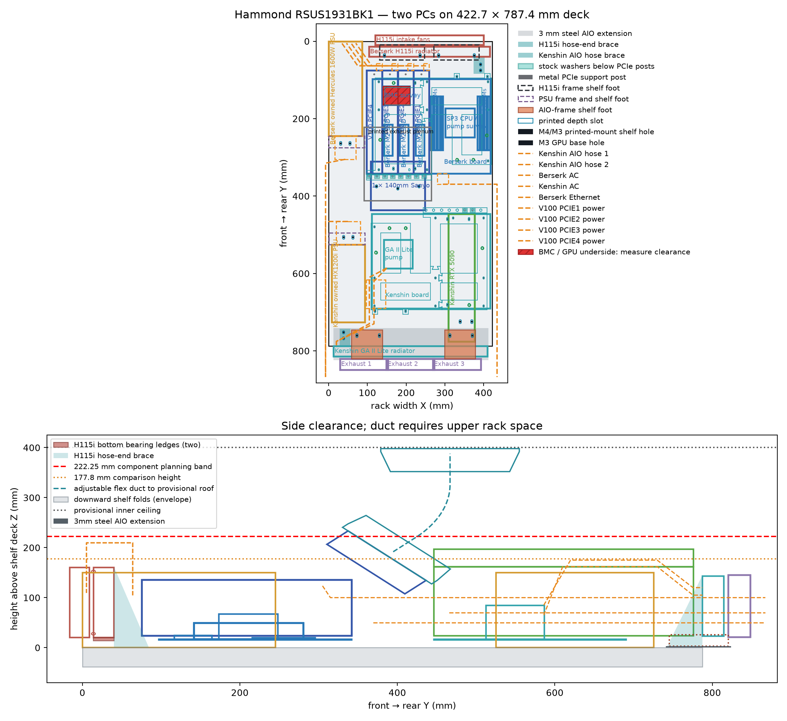
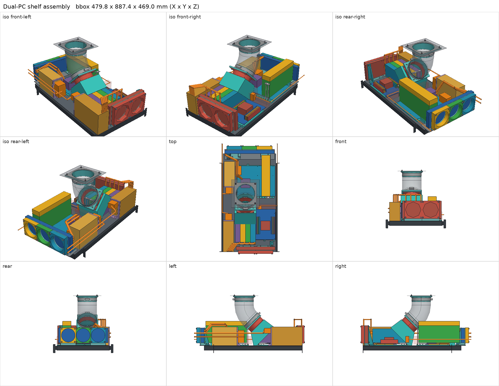

# AIPC: two AI workstations on one rack shelf

Two PCs arranged front to back on a **Hammond RSUS1931BK1 sliding shelf**, using printed mounts instead of cases. The solid tray is **422.656 × 787.4 mm**, with factory-matched slides. The overhead GPU exhaust needs additional rack height.

- **Berserk**: HUANANZHI H12D-8D with an AMD EPYC 7702P, **256 GB (8 × 32 GB) Micron DDR4-2933 ECC RDIMM**, and **four NVIDIA V100 PCIe** cards cooled by one 140 mm pressure fan through a printed hood and an overhead exhaust duct. Storage: **three 2 TB Micron NVMe drives (two 3400s, one 3500) in RAID 0** (6 TB nominal), holding the OS and model weights. Corsair H115i AIO at the front.
- **Kenshin**: Gigabyte X870E AORUS PRO with a Ryzen 9 9950X3D and an **RTX 5090**. Lian Li GA II LITE 360 AIO at the rear.





Everything is generated from Python ([CadQuery](https://cadquery.readthedocs.io/)) and checked in CAD for collisions, fastener access and bed fit. The design is a **fit prototype**: the CAD and slicer checks pass, but parts of it (GPU flange positions, the H12D board, cable bends, thermal behavior) still need measuring and dry-fitting on real hardware. The [design notes](docs/design.md) say what is verified and what is not.

## What's here

| Path | Contents |
| --- | --- |
| [parts/](parts/README.md) | One folder per part: spec with evidence-tagged dimensions and interfaces, datasheet links, the model used in the assembly, and renders |
| [docs/process.md](docs/process.md) | The design process: part folders, renders, one assembly, whole-system compatibility checks |
| [docs/system-check.md](docs/system-check.md) | Latest compatibility, assembly-coverage and evidence report (generated) |
| [parts.xlsx](parts.xlsx) | Parts spreadsheet with tabs for the shelf hardware, Berserk and Kenshin |
| [docs/design.md](docs/design.md) | How the layout, mounts and cooling work, with coordinates and open checks |
| [docs/assembly.md](docs/assembly.md) | Assembly order, fastener stacks and what to tighten before it gets covered |
| [docs/printing.md](docs/printing.md) | 3D printing guidelines: printer, materials, design and printability rules |
| [models/](models) | Assembly STEP, drill-plan deck, fit and coverage reports, layout figures and [assembly renders](models/renders/assembly.png) |
| [print/](print/README.md) | Print plates (3MF) for the Qidi X-Plus, slicer profiles and the plate manifest |
| [cad/](cad) | Generators and the shared [aipc library](cad/aipc): [shelf_layout.py](cad/shelf_layout.py) builds the assembly and models; [render_all.py](cad/render_all.py) renders; [check_system.py](cad/check_system.py) checks compatibility; [print_jobs.py](cad/print_jobs.py) packs plates; [slice_jobs.py](cad/slice_jobs.py) slices and validates G-code |

The [assembly STEP](models/dual-pc-hammond-assembly.step) includes the solid deck, downward folds and illustrative factory slide envelopes. [Hammond dimensions and limitations](models/hammond-shelf-report.json): 711.2 mm travel, 457.2–711.2 mm mounting depth, 39 kg equipment limit; 2U mounting / 3U shelf clearance. The complete PC/duct assembly occupies more height. The deeper layout turns Kenshin 180°, clears its inward-facing ports, and places its GPU opposite the V100 hood. The rear radiator needs about 65 mm beyond the deck and longer printed feet on a 400 × 83 × 3 mm steel extension; verify cabinet depth and loaded deflection. Power down and disconnect rack cables and the roof duct before extending.

The previous StarTech/King Slide conversion and shim trials are retired. Buying the Hammond shelf has not been confirmed; its price remains blank in the parts sheet.

## Printed parts

One model per unique part, in its folder under [parts/printed/](parts/README.md#printed); the plate manifest says how many to print.

| Part | Qty | Used for |
| --- | ---: | --- |
| `atx_mobo_adapter_front` | 2 | Shelf-front half of each motherboard adapter (common to both boards) |
| `atx_mobo_adapter_rail` | 1 | Rear half with GPU-post rail at standard ATX positions (Kenshin) |
| `h12d_mobo_adapter_rail` | 1 | Rear half with the rail shifted for four dual-slot V100s (Berserk) |
| `psu_bracket` | 2 | Rear restraint for an 86 × 150 mm ATX PSU face (both PSUs) |
| `fan140_aio_frame` | 2 | 140 mm fan/radiator frame with bearing ledge (H115i) |
| `fan140_aio_hose_brace` | 1 | Hose-end brace for the 140 mm radiator |
| `fan120_aio_frame` | 2 | 120 mm fan/radiator frame with bearing ledge (360 mm AIO) |
| `fan120_aio_hose_brace` | 1 | Hose-end brace for the 120 mm radiator |
| `fan120_aio_center_spacer` | 1 | Keeps the middle 120 mm fan coplanar |
| `gpu_rest` | 1 | Front-end rest for the RTX 5090 |
| `v100_gpu_shroud` | 1 | Hood over the four V100s with integral 45° fan panel |
| `gpu_exhaust_fan_flange` | 1 | Fan outlet to 6-inch duct |
| `gpu_exhaust_roof_flange` | 1 | Duct to cabinet inner ceiling |
| `tnut_fit_coupon` | 1 | Test print for the M4 T-nut pocket |


## Regenerating

Requires Python 3.11+ and, for G-code, [OrcaSlicer](https://github.com/SoftFever/OrcaSlicer) 2.5.x (Qidi base presets are vendored in `print/profiles/orca-2.5.0/`).

```bash
make setup
```

```bash
make all
```

```bash
make gcode
```

`make all` runs `make cad` (assembly, reports and every part model, about a minute), `make render` (part and assembly renders, about two minutes), `make plates` (3MF plates in `print/`) and `make check` (compatibility report; it exits non-zero while any check FAILs). `make datasheets` downloads the datasheets listed in each `part.toml`, and `make gcode` slices every plate into `print/gcode/`. G-code is not committed; it is always generated from the plates and profiles. Run `make help` for the full list.

The plates target a first-generation **Qidi X-Plus** with a 0.4 mm nozzle: PETG for most mounts and Polymaker HT-PLA-GF (hardened steel nozzle) for the PSU brackets and GPU cooling parts. For another printer, change the bed size in [cad/print_jobs.py](cad/print_jobs.py), the machine preset in [cad/slice_jobs.py](cad/slice_jobs.py) and the profiles in [print/profiles/](print/profiles), and read [docs/printing.md](docs/printing.md) first.

## Adapting it

The generators are parametric but written for this hardware. Common changes:

- **Different shelf positions**: component placement lives at the top of [cad/shelf_layout.py](cad/shelf_layout.py); every printed mount, shelf hole and clearance check follows from it.
- **Different GPUs or slots**: the rear rail's eight post-slot positions are in [cad/atx_shelf_mounts.py](cad/atx_shelf_mounts.py) (`POST_SLOT_X`) and [cad/berserk_platform.py](cad/berserk_platform.py) for the H12D.
- **Different AIOs**: the 140 mm frame is `radiator_screw_frame()` in [cad/shelf_layout.py](cad/shelf_layout.py); the 120 mm frame and braces are in [cad/kenshin_aio_mount.py](cad/kenshin_aio_mount.py) and [cad/berserk_aio_brace.py](cad/berserk_aio_brace.py).
- **Shelf and slides**: dimensions and evidence are in [cad/hammond_shelf.py](cad/hammond_shelf.py); installed transforms are in [cad/rack_shelf_coordinates.py](cad/rack_shelf_coordinates.py).

The script asserts on every collision and access check, so a change that breaks the layout fails loudly instead of exporting a bad part.

## License

[MIT](LICENSE): covers the code, models, print files and docs.
