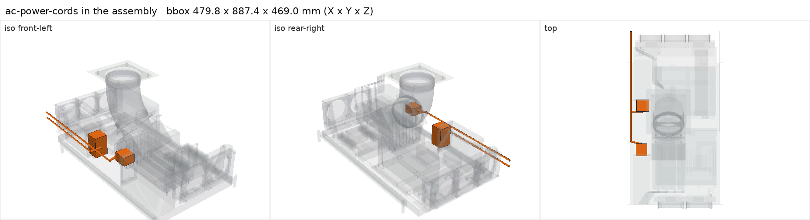

# AC power cords

<!-- Generated by make check from ac-power-cords.toml and the library part.toml. Edit those, not this file. -->

Library spec: [parts/purchased/ac-power-cords](../../parts/purchased/ac-power-cords/README.md) (dimensions, interfaces, datasheets, model).

| | |
| --- | --- |
| Role | PSU mains cords |
| Status | candidate |
| Quantity | 2 |
| Systems | berserk, kenshin |

## Assembly

- 6 instances in the assembly

