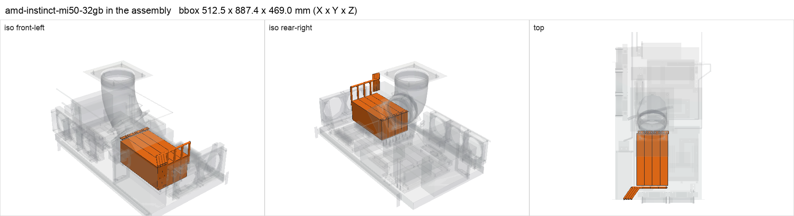

# AMD Radeon Instinct MI50 32 GB

<!-- Generated by make check from amd-instinct-mi50-32gb.toml and the library part.toml. Edit those, not this file. -->

Library spec: [parts/purchased/amd-instinct-mi50-32gb](../../parts/purchased/amd-instinct-mi50-32gb/README.md) (dimensions, interfaces, datasheets, model).

| | |
| --- | --- |
| Role | Berserk GPUs (passive, ducted) |
| Status | selected |
| Quantity | 4 |
| Systems | berserk |

Replaces the four V100s (owner, 2026-11-27). Same bracket plane as the V100s, so
the printed rail posts and the hood are unchanged; the 0.3 mm longer body moves
the tail ends toward the front radiator. The card body and its power cable
route are one unit here: one Hercules dual-head PCIe 8-pin cable per card.

## Changes for this build

- requires `dc-power`: sets load_limited 180 — rocm-smi power cap 180 W per card for first runs, set at boot; four uncapped cards (1,200 W) overload the Hercules budget

## Assembly

- 24 instances in the assembly

## Compatibility checks

| Status | Rule | Interface | Detail |
| --- | --- | --- | --- |
| BLOCKED | budget | `shelf-load` | load 18.2 kg of 39.0 kg x derate 1.0 = 39.0 kg (47% of rating); unknown load for ['amd-instinct-mi50-32gb'] |
| provisional | budget | `dc-power` | load 1096.0 W of 1600.0 W x derate 0.8 = 1280.0 W (68% of rating); relies on configured limits of ['amd-instinct-mi50-32gb']; unlimited peak 1576.0 W |
| provisional | count | `gpu-forced-airflow` | need 4 x gpu-forced-airflow, have 4 |
| provisional | count | `pcie-8pin` | need 8 x pcie-8pin, have 16 |
| provisional | value | `pcie-card-envelope` | amd-instinct-mi50-32gb needs 40.0; provided by huananzhi-h12d-8d |
| pass | value | `pcie-x16-slot` | amd-instinct-mi50-32gb needs PCIe x16; provided by huananzhi-h12d-8d |
| pass | count | `pcie-x16-slot` | need 4 x pcie-x16-slot=pcie x16, have 4 |

