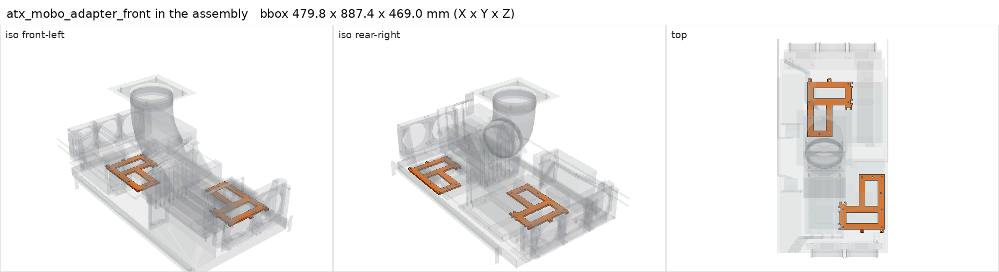

# atx_mobo_adapter_front

<!-- Generated by make check from atx_mobo_adapter_front.toml and the library part.toml. Edit those, not this file. -->

Library spec: [parts/printed/atx_mobo_adapter_front](../../parts/printed/atx_mobo_adapter_front/README.md) (dimensions, interfaces, datasheets, model).

| | |
| --- | --- |
| Role | shelf-front motherboard section, common to both boards |
| Status | design |
| Quantity | 2 |
| Systems | berserk, kenshin |

## Assembly

- 2 instances in the assembly

## Compatibility checks

| Status | Rule | Interface | Detail |
| --- | --- | --- | --- |
| provisional | value | `mobo-front-section` | gigabyte-x870e-aorus-pro needs ATX; provided by atx_mobo_adapter_front |
| provisional | value | `mobo-front-section` | huananzhi-h12d-8d needs ATX; provided by atx_mobo_adapter_front |
| provisional | count | `mobo-front-section` | need 2 x mobo-front-section=atx, have 2 |
| provisional | budget | `shelf-load` | load 23.8 kg of 39.0 kg x derate 1.0 = 39.0 kg (61% of rating) |

