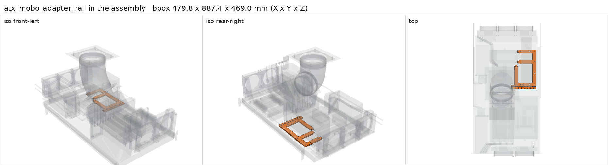

# atx_mobo_adapter_rail

<!-- Generated by make check from atx_mobo_adapter_rail.toml and the library part.toml. Edit those, not this file. -->

Library spec: [parts/printed/atx_mobo_adapter_rail](../../parts/printed/atx_mobo_adapter_rail/README.md) (dimensions, interfaces, datasheets, model).

| | |
| --- | --- |
| Role | Kenshin rear rail with GPU post holes at standard ATX positions |
| Status | design |
| Quantity | 1 |
| Systems | kenshin |

## Assembly

- 1 instances in the assembly

## Compatibility checks

| Status | Rule | Interface | Detail |
| --- | --- | --- | --- |
| provisional | value | `mobo-rear-rail` | gigabyte-x870e-aorus-pro needs ATX standard slot positions; provided by atx_mobo_adapter_rail |
| provisional | count | `mobo-rear-rail` | need 1 x mobo-rear-rail=atx standard slot positions, have 1 |
| provisional | budget | `shelf-load` | load 23.8 kg of 39.0 kg x derate 1.0 = 39.0 kg (61% of rating) |

