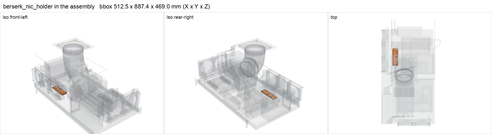

# berserk_nic_holder

<!-- Generated by make check from berserk_nic_holder.toml and the library part.toml. Edit those, not this file. -->

Library spec: [parts/printed/berserk_nic_holder](../../parts/printed/berserk_nic_holder/README.md) (dimensions, interfaces, datasheets, model).

| | |
| --- | --- |
| Role | holds Berserk's LRFC6911N riser and ConnectX-4 Lx beside Kenshin's side AIO |
| Status | design |
| Quantity | 1 |
| Systems | berserk |

## Assembly

- 1 instances in the assembly

## Compatibility checks

| Status | Rule | Interface | Detail |
| --- | --- | --- | --- |
| BLOCKED | budget | `shelf-load` | load 18.2 kg of 39.0 kg x derate 1.0 = 39.0 kg (47% of rating); unknown load for ['amd-instinct-mi50-32gb'] |

