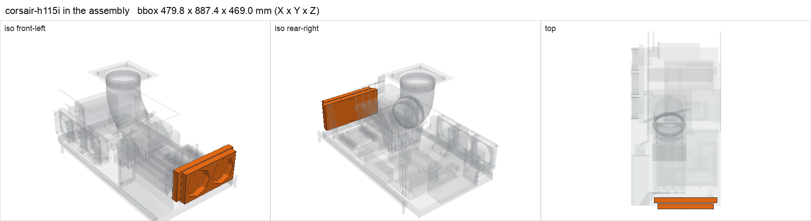

# Corsair Hydro H115i 280 mm AIO (reused)

<!-- Generated by make check from corsair-h115i.toml and the library part.toml. Edit those, not this file. -->

Library spec: [parts/purchased/corsair-h115i](../../parts/purchased/corsair-h115i/README.md) (dimensions, interfaces, datasheets, model).

| | |
| --- | --- |
| Role | Berserk CPU cooler, front of shelf |
| Status | owned |
| Quantity | 1 |
| Systems | berserk |

## Assembly

- 2 instances in the assembly

## Compatibility checks

| Status | Rule | Interface | Detail |
| --- | --- | --- | --- |
| provisional | value | `aio-pump-mount` | asetek-tr4-bracket needs Asetek round pump; provided by corsair-h115i |
| provisional | count | `aio-pump-mount` | need 1 x aio-pump-mount=asetek round pump, have 1 |
| provisional | value | `cooler-mount` | amd-epyc-7702p needs SP3; provided by asetek-tr4-bracket |
| provisional | budget | `dc-power` | load 1096.0 W of 1600.0 W x derate 0.8 = 1280.0 W (68% of rating); relies on configured limits of ['nvidia-v100-pcie-16gb']; unlimited peak 1376.0 W |
| provisional | value | `radiator-mount` | corsair-h115i needs 280 mm, 124.5 mm pitch; provided by fan140_aio_frame |
| provisional | count | `radiator-mount` | need 2 x radiator-mount=280 mm, 124.5 mm pitch, have 2 |
| provisional | budget | `shelf-load` | load 23.0 kg of 39.0 kg x derate 1.0 = 39.0 kg (59% of rating) |

