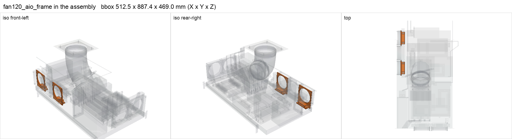

# fan120_aio_frame

<!-- Generated by make check from fan120_aio_frame.toml and the library part.toml. Edit those, not this file. -->

Library spec: [parts/printed/fan120_aio_frame](../../parts/printed/fan120_aio_frame/README.md) (dimensions, interfaces, datasheets, model).

| | |
| --- | --- |
| Role | 120 mm fan/radiator frame with 33 mm feet inside the AIO footprint, bearing on the deck |
| Status | design |
| Quantity | 2 |
| Systems | kenshin |

## Assembly

- 2 instances in the assembly

## Compatibility checks

| Status | Rule | Interface | Detail |
| --- | --- | --- | --- |
| BLOCKED | budget | `shelf-load` | load 18.2 kg of 39.0 kg x derate 1.0 = 39.0 kg (47% of rating); unknown load for ['amd-instinct-mi50-32gb'] |
| provisional | value | `radiator-mount` | lian-li-ga2-lite-360 needs 360 mm, 105 mm pitch; provided by fan120_aio_frame |
| provisional | count | `radiator-mount` | need 2 x radiator-mount=360 mm, 105 mm pitch, have 2 |

