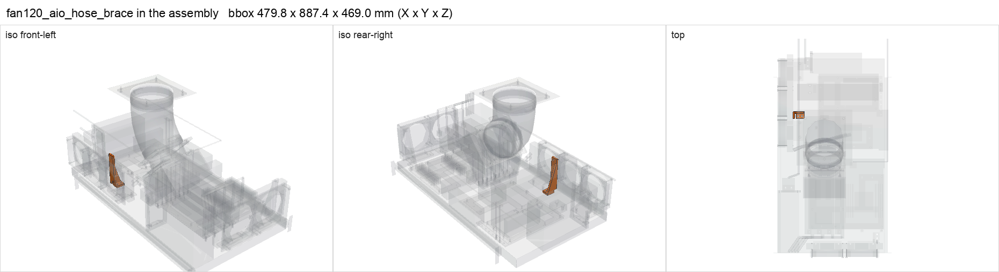

# fan120_aio_hose_brace

<!-- Generated by make check from fan120_aio_hose_brace.toml and the library part.toml. Edit those, not this file. -->

Library spec: [parts/printed/fan120_aio_hose_brace](../../parts/printed/fan120_aio_hose_brace/README.md) (dimensions, interfaces, datasheets, model).

| | |
| --- | --- |
| Role | mirrored left hose-end brace for the 120 mm radiator |
| Status | design |
| Quantity | 1 |
| Systems | kenshin |

## Assembly

- 1 instances in the assembly

## Compatibility checks

| Status | Rule | Interface | Detail |
| --- | --- | --- | --- |
| provisional | budget | `shelf-load` | load 23.0 kg of 39.0 kg x derate 1.0 = 39.0 kg (59% of rating) |

