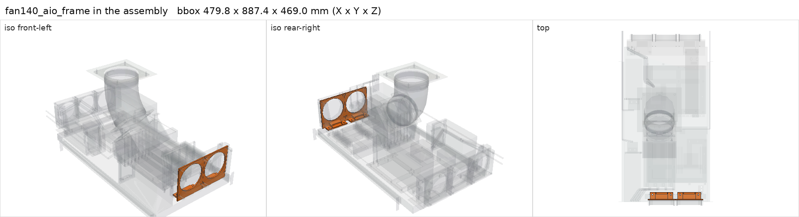

# fan140_aio_frame

<!-- Generated by make check from fan140_aio_frame.toml and the library part.toml. Edit those, not this file. -->

Library spec: [parts/printed/fan140_aio_frame](../../parts/printed/fan140_aio_frame/README.md) (dimensions, interfaces, datasheets, model).

| | |
| --- | --- |
| Role | 140 mm fan/radiator frame with bearing ledge (H115i) |
| Status | design |
| Quantity | 2 |
| Systems | berserk |

## Assembly

- 2 instances in the assembly

## Compatibility checks

| Status | Rule | Interface | Detail |
| --- | --- | --- | --- |
| provisional | value | `radiator-mount` | corsair-h115i needs 280 mm, 124.5 mm pitch; provided by fan140_aio_frame |
| provisional | count | `radiator-mount` | need 2 x radiator-mount=280 mm, 124.5 mm pitch, have 2 |
| provisional | budget | `shelf-load` | load 23.8 kg of 39.0 kg x derate 1.0 = 39.0 kg (61% of rating) |

