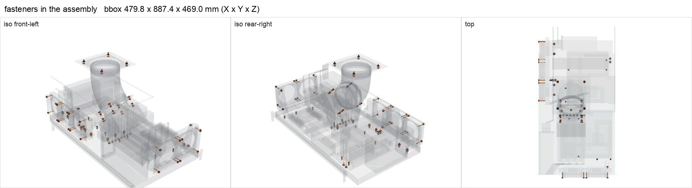

# Shelf and component fasteners (metric and UNC screws, washers, nuts)

<!-- Generated by make check from fasteners.toml and the library part.toml. Edit those, not this file. -->

Library spec: [parts/purchased/fasteners](../../parts/purchased/fasteners/README.md) (dimensions, interfaces, datasheets, model).

| | |
| --- | --- |
| Role | 45 shelf joints plus radiator, fan, flange and roof screws |
| Status | candidate |
| Quantity | 1 |
| Systems | berserk, kenshin, shelf |

M3/M4 hardware; lengths from the measured stacks in docs/assembly.md.

## Changes for this build

| Key | Value | Evidence | Source / note |
| --- | --- | --- | --- |
| mass | 0.6 kg | assumed |  |

## Assembly

- 87 instances in the assembly

## Compatibility checks

| Status | Rule | Interface | Detail |
| --- | --- | --- | --- |
| provisional | budget | `shelf-load` | load 23.0 kg of 39.0 kg x derate 1.0 = 39.0 kg (59% of rating) |

