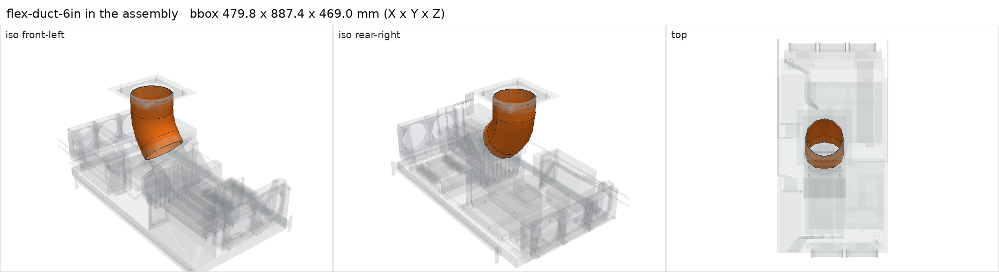

# 6 in wire-supported flexible duct, uninsulated

<!-- Generated by make check from flex-duct-6in.toml and the library part.toml. Edit those, not this file. -->

Library spec: [parts/purchased/flex-duct-6in](../../parts/purchased/flex-duct-6in/README.md) (dimensions, interfaces, datasheets, model).

| | |
| --- | --- |
| Role | GPU exhaust to cabinet ceiling |
| Status | candidate |
| Quantity | 1 |
| Systems | berserk |

## Assembly

- 1 instances in the assembly

## Compatibility checks

| Status | Rule | Interface | Detail |
| --- | --- | --- | --- |
| provisional | value | `duct-connection` | flex-duct-6in needs 6 in; provided by gpu_exhaust_fan_flange, gpu_exhaust_roof_flange |
| provisional | count | `duct-connection` | need 2 x duct-connection=6 in, have 2 |

