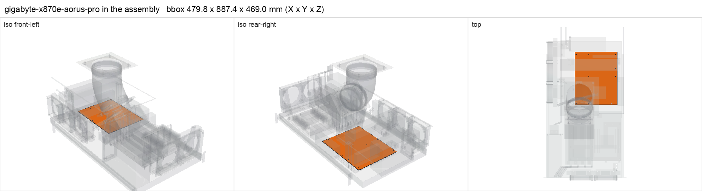

# Gigabyte X870E AORUS PRO (ATX)

<!-- Generated by make check from gigabyte-x870e-aorus-pro.toml and the library part.toml. Edit those, not this file. -->

Library spec: [parts/purchased/gigabyte-x870e-aorus-pro](../../parts/purchased/gigabyte-x870e-aorus-pro/README.md) (dimensions, interfaces, datasheets, model).

| | |
| --- | --- |
| Role | Kenshin motherboard |
| Status | owned |
| Quantity | 1 |
| Systems | kenshin |

## Assembly

- 1 instances in the assembly

## Compatibility checks

| Status | Rule | Interface | Detail |
| --- | --- | --- | --- |
| provisional | count | `atx-24pin` | need 1 x atx-24pin, have 1 |
| provisional | value | `board-standoff` | gigabyte-x870e-aorus-pro needs #6-32 F/F; provided by keystone-1451b |
| provisional | count | `board-standoff` | need 17 x board-standoff=#6-32 f/f, have 17 |
| provisional | budget | `dc-power` | load 908.0 W of 1200.0 W x derate 0.8 = 960.0 W (76% of rating) |
| provisional | count | `eps-8pin-cpu` | need 2 x eps-8pin-cpu, have 2 |
| provisional | value | `m2-slot` | samsung-990-pro-4tb needs M.2 2280 NVMe; provided by gigabyte-x870e-aorus-pro |
| provisional | count | `m2-slot` | need 2 x m2-slot=m.2 2280 nvme, have 4 |
| provisional | value | `memory-slot` | corsair-cmp64gx5m4b6400c32 needs DDR5 UDIMM; provided by gigabyte-x870e-aorus-pro |
| provisional | count | `memory-slot` | need 4 x memory-slot=ddr5 udimm, have 4 |
| provisional | value | `mobo-front-section` | gigabyte-x870e-aorus-pro needs ATX; provided by atx_mobo_adapter_front |
| provisional | count | `mobo-front-section` | need 2 x mobo-front-section=atx, have 2 |
| provisional | value | `mobo-rear-rail` | gigabyte-x870e-aorus-pro needs ATX standard slot positions; provided by atx_mobo_adapter_rail |
| provisional | count | `mobo-rear-rail` | need 1 x mobo-rear-rail=atx standard slot positions, have 1 |
| provisional | value | `pcie-x4-slot` | nvidia-mcx4131a-gcat needs PCIe x8 card, x4 link; provided by gigabyte-x870e-aorus-pro, linkreal-lrfc6911n |
| provisional | count | `pcie-x4-slot` | need 2 x pcie-x4-slot=pcie x8 card, x4 link, have 3 |
| provisional | budget | `shelf-load` | load 23.0 kg of 39.0 kg x derate 1.0 = 39.0 kg (59% of rating) |
| pass | value | `cpu-socket` | amd-ryzen-9-9950x3d needs AM5; provided by gigabyte-x870e-aorus-pro |
| pass | value | `pcie-x16-slot` | zotac-rtx-5090-solid needs PCIe x16; provided by gigabyte-x870e-aorus-pro |
| pass | count | `pcie-x16-slot` | need 1 x pcie-x16-slot=pcie x16, have 1 |

