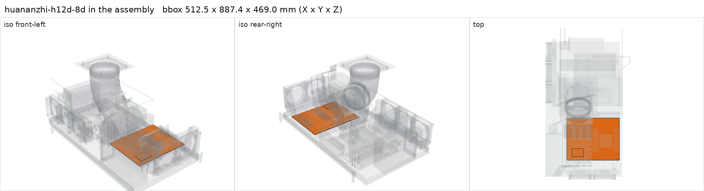

# HUANANZHI H12D-8D motherboard with BMC

<!-- Generated by make check from huananzhi-h12d-8d.toml and the library part.toml. Edit those, not this file. -->

Library spec: [parts/purchased/huananzhi-h12d-8d](../../parts/purchased/huananzhi-h12d-8d/README.md) (dimensions, interfaces, datasheets, model).

| | |
| --- | --- |
| Role | Berserk motherboard |
| Status | owned |
| Quantity | 1 |
| Systems | berserk |

## Changes for this build

- requires `mobo-front-section`: sets value ATX, count 1, evidence listing
- requires `mobo-rear-rail`: sets value H12D-8D slot positions, count 1, evidence listing

## Assembly

- 2 instances in the assembly

## Compatibility checks

| Status | Rule | Interface | Detail |
| --- | --- | --- | --- |
| BLOCKED | count | `usb2-header` | need 1 x usb2-header, have None |
| provisional | count | `atx-24pin` | need 1 x atx-24pin, have 1 |
| provisional | value | `board-standoff` | huananzhi-h12d-8d needs #6-32 F/F; provided by keystone-1451b |
| provisional | count | `board-standoff` | need 17 x board-standoff=#6-32 f/f, have 17 |
| provisional | budget | `dc-power` | load 1096.0 W of 1600.0 W x derate 0.8 = 1280.0 W (68% of rating); relies on configured limits of ['nvidia-v100-pcie-16gb']; unlimited peak 1376.0 W |
| provisional | count | `eps-8pin-cpu` | need 2 x eps-8pin-cpu, have 2 |
| provisional | value | `m2-slot` | micron-3400-2tb needs M.2 2280 NVMe; provided by huananzhi-h12d-8d |
| provisional | value | `m2-slot` | micron-3500-2tb needs M.2 2280 NVMe; provided by huananzhi-h12d-8d |
| provisional | count | `m2-slot` | need 3 x m2-slot=m.2 2280 nvme, have 3 |
| provisional | value | `memory-slot` | micron-mta36asf4g72pz-2g9 needs DDR4 RDIMM; provided by huananzhi-h12d-8d |
| provisional | count | `memory-slot` | need 8 x memory-slot=ddr4 rdimm, have 8 |
| provisional | value | `mobo-front-section` | huananzhi-h12d-8d needs ATX; provided by atx_mobo_adapter_front |
| provisional | count | `mobo-front-section` | need 2 x mobo-front-section=atx, have 2 |
| provisional | value | `mobo-rear-rail` | huananzhi-h12d-8d needs H12D-8D slot positions; provided by h12d_mobo_adapter_rail |
| provisional | count | `mobo-rear-rail` | need 1 x mobo-rear-rail=h12d-8d slot positions, have 1 |
| provisional | value | `pcie-card-envelope` | nvidia-v100-pcie-16gb needs 40.0; provided by huananzhi-h12d-8d |
| provisional | value | `sff-8643-port` | sff-8643-pcie-cable needs PCIe x4 device; provided by linkreal-lrfc6911n |
| provisional | count | `sff-8643-port` | need 1 x sff-8643-port=pcie x4 device, have 1 |
| provisional | budget | `shelf-load` | load 23.1 kg of 39.0 kg x derate 1.0 = 39.0 kg (59% of rating) |
| pass | value | `cpu-socket` | amd-epyc-7702p needs SP3; provided by huananzhi-h12d-8d |
| pass | value | `pcie-x16-slot` | nvidia-v100-pcie-16gb needs PCIe x16; provided by huananzhi-h12d-8d |
| pass | count | `pcie-x16-slot` | need 4 x pcie-x16-slot=pcie x16, have 4 |
| pass | value | `sff-8643-port` | sff-8643-pcie-cable needs PCIe 4.0 x4 U.2; provided by huananzhi-h12d-8d |
| pass | count | `sff-8643-port` | need 1 x sff-8643-port=pcie 4.0 x4 u.2, have 3 |

