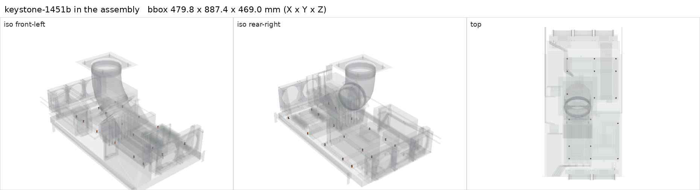

# Keystone 1451B #6-32 F/F brass standoff, 3/8 in

<!-- Generated by make check from keystone-1451b.toml and the library part.toml. Edit those, not this file. -->

Library spec: [parts/purchased/keystone-1451b](../../parts/purchased/keystone-1451b/README.md) (dimensions, interfaces, datasheets, model).

| | |
| --- | --- |
| Role | motherboard standoffs |
| Status | selected |
| Quantity | 17 |
| Systems | berserk, kenshin |

## Assembly

- 17 instances in the assembly

## Compatibility checks

| Status | Rule | Interface | Detail |
| --- | --- | --- | --- |
| provisional | value | `board-standoff` | gigabyte-x870e-aorus-pro needs #6-32 F/F; provided by keystone-1451b |
| provisional | value | `board-standoff` | huananzhi-h12d-8d needs #6-32 F/F; provided by keystone-1451b |
| provisional | count | `board-standoff` | need 17 x board-standoff=#6-32 f/f, have 17 |
| provisional | budget | `shelf-load` | load 23.8 kg of 39.0 kg x derate 1.0 = 39.0 kg (61% of rating) |

