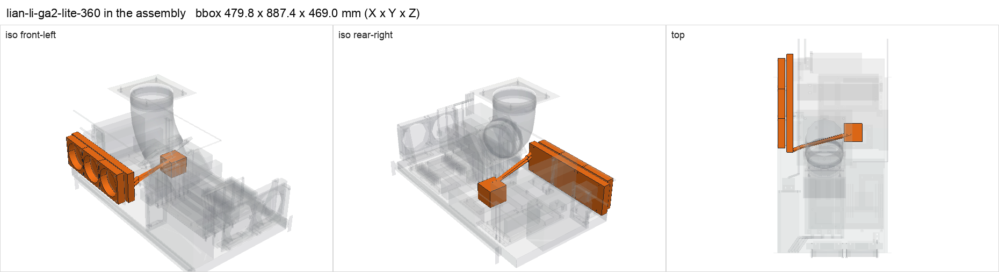

# Lian Li GA II LITE Performance 360 (GA2L36PB)

<!-- Generated by make check from lian-li-ga2-lite-360.toml and the library part.toml. Edit those, not this file. -->

Library spec: [parts/purchased/lian-li-ga2-lite-360](../../parts/purchased/lian-li-ga2-lite-360/README.md) (dimensions, interfaces, datasheets, model).

| | |
| --- | --- |
| Role | Kenshin CPU cooler, rear of shelf |
| Status | owned |
| Quantity | 1 |
| Systems | kenshin |

## Assembly

- 9 instances in the assembly

## Compatibility checks

| Status | Rule | Interface | Detail |
| --- | --- | --- | --- |
| provisional | budget | `dc-power` | load 908.0 W of 1200.0 W x derate 0.8 = 960.0 W (76% of rating) |
| provisional | value | `radiator-mount` | lian-li-ga2-lite-360 needs 360 mm, 105 mm pitch; provided by fan120_aio_frame |
| provisional | count | `radiator-mount` | need 2 x radiator-mount=360 mm, 105 mm pitch, have 2 |
| provisional | budget | `shelf-load` | load 23.0 kg of 39.0 kg x derate 1.0 = 39.0 kg (59% of rating) |
| pass | value | `cooler-mount` | amd-ryzen-9-9950x3d needs AM5; provided by lian-li-ga2-lite-360 |

