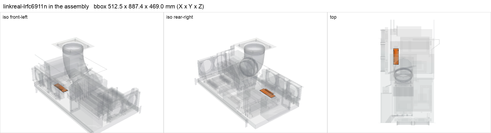

# Linkreal (LR-Link) LRFC6911N, 1 x SFF-8643 to PCIe x16 slot (x4) adapter

<!-- Generated by make check from linkreal-lrfc6911n.toml and the library part.toml. Edit those, not this file. -->

Library spec: [parts/purchased/linkreal-lrfc6911n](../../parts/purchased/linkreal-lrfc6911n/README.md) (dimensions, interfaces, datasheets, model).

| | |
| --- | --- |
| Role | Berserk NIC slot: takes an H12D-8D SFF-8643 PCIe x4 port and provides an x16 slot for the ConnectX; lies flat in the printed berserk_nic_holder beside Kenshin's side AIO |
| Status | selected |
| Quantity | 1 |
| Systems | berserk |

## Assembly

- 2 instances in the assembly

## Compatibility checks

| Status | Rule | Interface | Detail |
| --- | --- | --- | --- |
| BLOCKED | budget | `shelf-load` | load 18.2 kg of 39.0 kg x derate 1.0 = 39.0 kg (47% of rating); unknown load for ['amd-instinct-mi50-32gb'] |
| provisional | value | `pcie-x4-slot` | nvidia-mcx4131a-gcat needs PCIe x8 card, x4 link; provided by gigabyte-x870e-aorus-pro, linkreal-lrfc6911n |
| provisional | count | `pcie-x4-slot` | need 2 x pcie-x4-slot=pcie x8 card, x4 link, have 3 |
| provisional | count | `sata-power` | need 1 x sata-power, have 16 |
| provisional | value | `sff-8643-port` | sff-8643-pcie-cable needs PCIe x4 device; provided by linkreal-lrfc6911n |
| provisional | count | `sff-8643-port` | need 1 x sff-8643-port=pcie x4 device, have 1 |
| pass | value | `sff-8643-port` | sff-8643-pcie-cable needs PCIe 4.0 x4 U.2; provided by huananzhi-h12d-8d |
| pass | count | `sff-8643-port` | need 1 x sff-8643-port=pcie 4.0 x4 u.2, have 3 |

