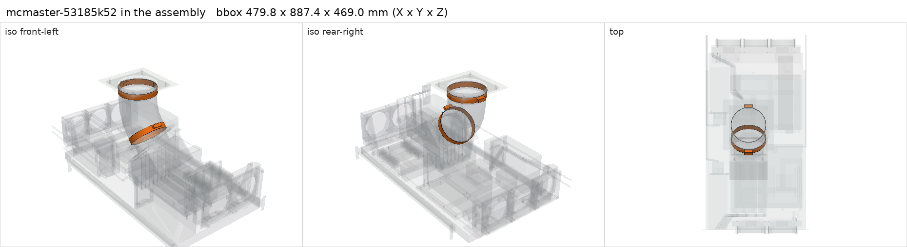

# McMaster-Carr 53185K52 lever-release hose clamp

<!-- Generated by make check from mcmaster-53185k52.toml and the library part.toml. Edit those, not this file. -->

Library spec: [parts/purchased/mcmaster-53185k52](../../parts/purchased/mcmaster-53185k52/README.md) (dimensions, interfaces, datasheets, model).

| | |
| --- | --- |
| Role | duct clamps |
| Status | selected |
| Quantity | 2 |
| Systems | berserk |

## Assembly

- 2 instances in the assembly

