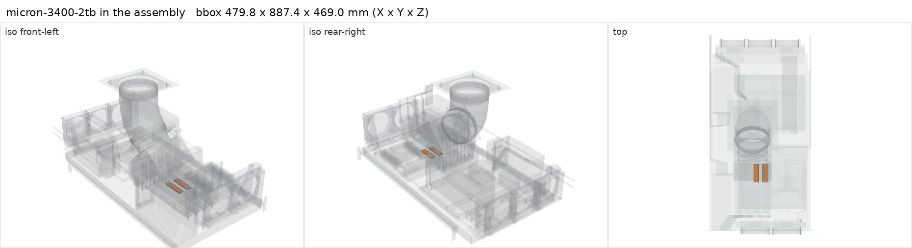

# Micron 3400 2 TB NVMe (MTFDKBA2T0TFH)

<!-- Generated by make check from micron-3400-2tb.toml and the library part.toml. Edit those, not this file. -->

Library spec: [parts/purchased/micron-3400-2tb](../../parts/purchased/micron-3400-2tb/README.md) (dimensions, interfaces, datasheets, model).

| | |
| --- | --- |
| Role | Berserk model storage, two of the three RAID 0 members |
| Status | owned |
| Quantity | 2 |
| Systems | berserk |

## Assembly

- 2 instances in the assembly

## Compatibility checks

| Status | Rule | Interface | Detail |
| --- | --- | --- | --- |
| provisional | budget | `dc-power` | load 1096.0 W of 1600.0 W x derate 0.8 = 1280.0 W (68% of rating); relies on configured limits of ['nvidia-v100-pcie-16gb']; unlimited peak 1376.0 W |
| provisional | value | `m2-slot` | micron-3400-2tb needs M.2 2280 NVMe; provided by huananzhi-h12d-8d |
| provisional | count | `m2-slot` | need 3 x m2-slot=m.2 2280 nvme, have 3 |
| provisional | budget | `shelf-load` | load 23.8 kg of 39.0 kg x derate 1.0 = 39.0 kg (61% of rating) |

