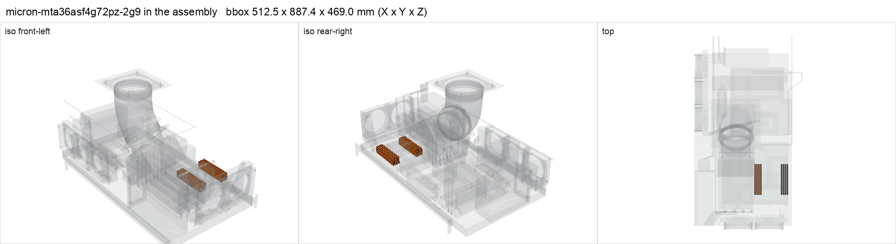

# Micron 32 GB DDR4-2933 ECC RDIMM (MTA36ASF4G72PZ-2G9E2UI)

<!-- Generated by make check from micron-mta36asf4g72pz-2g9.toml and the library part.toml. Edit those, not this file. -->

Library spec: [parts/purchased/micron-mta36asf4g72pz-2g9](../../parts/purchased/micron-mta36asf4g72pz-2g9/README.md) (dimensions, interfaces, datasheets, model).

| | |
| --- | --- |
| Role | Berserk memory, 8 x 32 GB |
| Status | owned |
| Quantity | 8 |
| Systems | berserk |

## Assembly

- 8 instances in the assembly

## Compatibility checks

| Status | Rule | Interface | Detail |
| --- | --- | --- | --- |
| BLOCKED | budget | `shelf-load` | load 18.2 kg of 39.0 kg x derate 1.0 = 39.0 kg (47% of rating); unknown load for ['amd-instinct-mi50-32gb'] |
| provisional | budget | `dc-power` | load 1096.0 W of 1600.0 W x derate 0.8 = 1280.0 W (68% of rating); relies on configured limits of ['amd-instinct-mi50-32gb']; unlimited peak 1576.0 W |
| provisional | value | `memory-slot` | micron-mta36asf4g72pz-2g9 needs DDR4 RDIMM; provided by huananzhi-h12d-8d |
| provisional | count | `memory-slot` | need 8 x memory-slot=ddr4 rdimm, have 8 |

