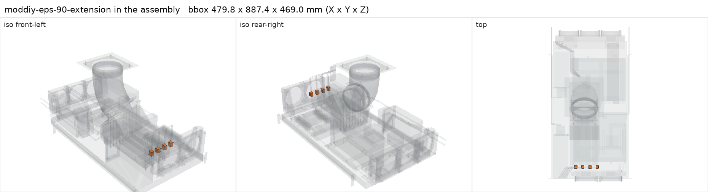

# Low-profile 90 degree CPU/EPS 8-pin extension

<!-- Generated by make check from moddiy-eps-90-extension.toml and the library part.toml. Edit those, not this file. -->

Library spec: [parts/purchased/moddiy-eps-90-extension](../../parts/purchased/moddiy-eps-90-extension/README.md) (dimensions, interfaces, datasheets, model).

| | |
| --- | --- |
| Role | keeps V100 power plugs low and clear of the front radiator |
| Status | selected |
| Quantity | 4 |
| Systems | berserk |

## Assembly

- 4 instances in the assembly

## Compatibility checks

| Status | Rule | Interface | Detail |
| --- | --- | --- | --- |
| provisional | budget | `shelf-load` | load 23.8 kg of 39.0 kg x derate 1.0 = 39.0 kg (61% of rating) |

