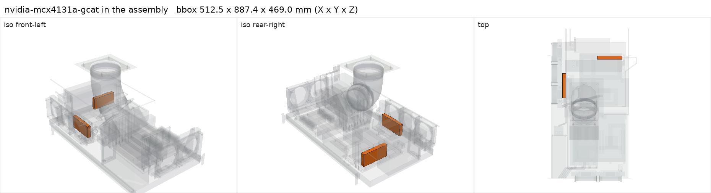

# NVIDIA (Mellanox) ConnectX-4 Lx EN MCX4131A-GCAT, 50GbE single-port QSFP28

<!-- Generated by make check from nvidia-mcx4131a-gcat.toml and the library part.toml. Edit those, not this file. -->

Library spec: [parts/purchased/nvidia-mcx4131a-gcat](../../parts/purchased/nvidia-mcx4131a-gcat/README.md) (dimensions, interfaces, datasheets, model).

| | |
| --- | --- |
| Role | Direct Berserk-Kenshin link over a QSFP28 DAC (one card per system) |
| Status | owned |
| Quantity | 2 |
| Systems | berserk, kenshin |

## Assembly

- 2 instances in the assembly

## Compatibility checks

| Status | Rule | Interface | Detail |
| --- | --- | --- | --- |
| BLOCKED | presence | `pcie-card-airflow` | nothing in systems ['berserk', 'kenshin'] provides 'pcie-card-airflow' |
| provisional | budget | `dc-power` | load 23.2 W of 2800.0 W x derate 0.8 = 2240.0 W (1% of rating) |
| provisional | value | `pcie-x4-slot` | nvidia-mcx4131a-gcat needs PCIe x8 card, x4 link; provided by gigabyte-x870e-aorus-pro, linkreal-lrfc6911n |
| provisional | count | `pcie-x4-slot` | need 2 x pcie-x4-slot=pcie x8 card, x4 link, have 3 |
| provisional | value | `qsfp28-dac` | nvidia-mcx4131a-gcat needs QSFP28 passive DAC, 50GbE; provided by qsfp28-passive-dac |
| provisional | count | `qsfp28-dac` | need 2 x qsfp28-dac=qsfp28 passive dac, 50gbe, have 2 |
| provisional | value | `qsfp28-port` | qsfp28-passive-dac needs QSFP28 50GbE; provided by nvidia-mcx4131a-gcat |
| provisional | count | `qsfp28-port` | need 2 x qsfp28-port=qsfp28 50gbe, have 2 |
| provisional | budget | `shelf-load` | load 23.1 kg of 39.0 kg x derate 1.0 = 39.0 kg (59% of rating) |

