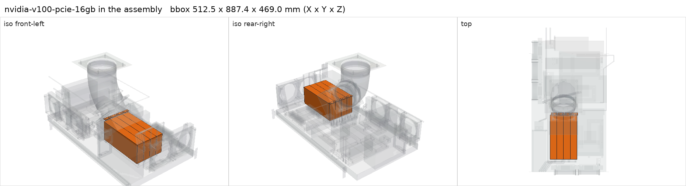

# NVIDIA Tesla V100 PCIe 16 GB

<!-- Generated by make check from nvidia-v100-pcie-16gb.toml and the library part.toml. Edit those, not this file. -->

Library spec: [parts/purchased/nvidia-v100-pcie-16gb](../../parts/purchased/nvidia-v100-pcie-16gb/README.md) (dimensions, interfaces, datasheets, model).

| | |
| --- | --- |
| Role | Berserk GPUs (passive, ducted) |
| Status | selected |
| Quantity | 4 |
| Systems | berserk |

## Assembly

- 8 instances in the assembly

## Compatibility checks

| Status | Rule | Interface | Detail |
| --- | --- | --- | --- |
| provisional | budget | `dc-power` | load 1096.0 W of 1600.0 W x derate 0.8 = 1280.0 W (68% of rating); relies on configured limits of ['nvidia-v100-pcie-16gb']; unlimited peak 1376.0 W |
| provisional | count | `gpu-forced-airflow` | need 4 x gpu-forced-airflow, have 4 |
| provisional | value | `pcie-card-envelope` | nvidia-v100-pcie-16gb needs 40.0; provided by huananzhi-h12d-8d |
| provisional | budget | `shelf-load` | load 23.1 kg of 39.0 kg x derate 1.0 = 39.0 kg (59% of rating) |
| provisional | value | `v100-aux-power` | nvidia-v100-pcie-16gb needs CPU/EPS 8-pin; provided by v100-eps-power-adapter |
| provisional | count | `v100-aux-power` | need 4 x v100-aux-power=cpu/eps 8-pin, have 4 |
| pass | value | `pcie-x16-slot` | nvidia-v100-pcie-16gb needs PCIe x16; provided by huananzhi-h12d-8d |
| pass | count | `pcie-x16-slot` | need 4 x pcie-x16-slot=pcie x16, have 4 |

