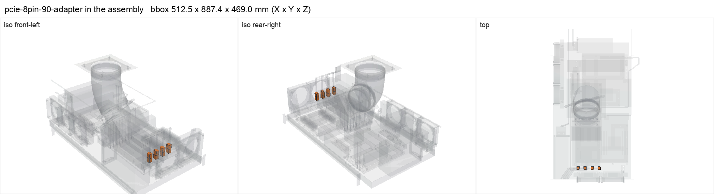

# 90 degree PCIe 8-pin power adapter (low profile)

<!-- Generated by make check from pcie-8pin-90-adapter.toml and the library part.toml. Edit those, not this file. -->

Library spec: [parts/purchased/pcie-8pin-90-adapter](../../parts/purchased/pcie-8pin-90-adapter/README.md) (dimensions, interfaces, datasheets, model).

| | |
| --- | --- |
| Role | keeps the MI50 power plugs low and clear of the front radiator |
| Status | candidate |
| Quantity | 8 |
| Systems | berserk |

## Assembly

- 8 instances in the assembly

## Compatibility checks

| Status | Rule | Interface | Detail |
| --- | --- | --- | --- |
| BLOCKED | budget | `shelf-load` | load 18.2 kg of 39.0 kg x derate 1.0 = 39.0 kg (47% of rating); unknown load for ['amd-instinct-mi50-32gb'] |

