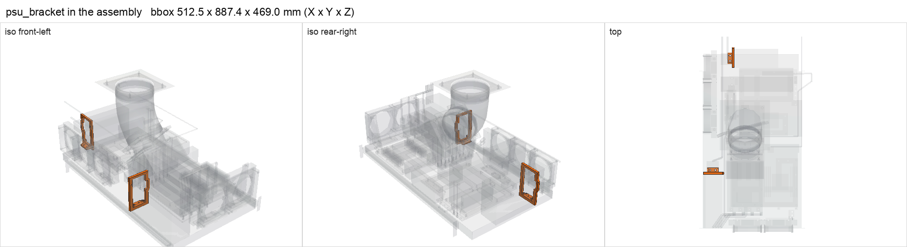

# psu_bracket

<!-- Generated by make check from psu_bracket.toml and the library part.toml. Edit those, not this file. -->

Library spec: [parts/printed/psu_bracket](../../parts/printed/psu_bracket/README.md) (dimensions, interfaces, datasheets, model).

| | |
| --- | --- |
| Role | rear restraint for an 86 x 150 mm ATX PSU face |
| Status | design |
| Quantity | 2 |
| Systems | berserk, kenshin |

## Assembly

- 2 instances in the assembly

## Compatibility checks

| Status | Rule | Interface | Detail |
| --- | --- | --- | --- |
| BLOCKED | budget | `shelf-load` | load 18.2 kg of 39.0 kg x derate 1.0 = 39.0 kg (47% of rating); unknown load for ['amd-instinct-mi50-32gb'] |
| provisional | value | `psu-restraint` | corsair-hx1200i needs ATX 150 x 86 face; provided by psu_bracket |
| provisional | value | `psu-restraint` | rosewill-hercules-1600 needs ATX 150 x 86 face; provided by psu_bracket |
| provisional | count | `psu-restraint` | need 2 x psu-restraint=atx 150 x 86 face, have 2 |

