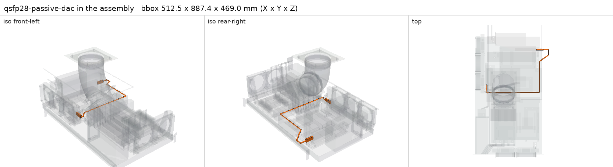

# QSFP28 passive copper direct-attach cable, 1 m (not chosen)

<!-- Generated by make check from qsfp28-passive-dac.toml and the library part.toml. Edit those, not this file. -->

Library spec: [parts/purchased/qsfp28-passive-dac](../../parts/purchased/qsfp28-passive-dac/README.md) (dimensions, interfaces, datasheets, model).

| | |
| --- | --- |
| Role | Direct Berserk-Kenshin 50GbE link between the two ConnectX-4 Lx cards |
| Status | candidate |
| Quantity | 1 |
| Systems | berserk, kenshin |

Routed from Berserk's card (bracket facing the rack front, beside the side
AIO) behind the V100 hood and above Kenshin's 24-pin, then rearward in the
right-edge lane to Kenshin's card. Kenshin's plug and the cable's turn sit
outside the deck edge and the 450 mm rack opening: unplug Kenshin's end
before sliding the shelf.

## Assembly

- 9 instances in the assembly

## Compatibility checks

| Status | Rule | Interface | Detail |
| --- | --- | --- | --- |
| provisional | value | `qsfp28-dac` | nvidia-mcx4131a-gcat needs QSFP28 passive DAC, 50GbE; provided by qsfp28-passive-dac |
| provisional | count | `qsfp28-dac` | need 2 x qsfp28-dac=qsfp28 passive dac, 50gbe, have 2 |
| provisional | value | `qsfp28-port` | qsfp28-passive-dac needs QSFP28 50GbE; provided by nvidia-mcx4131a-gcat |
| provisional | count | `qsfp28-port` | need 2 x qsfp28-port=qsfp28 50gbe, have 2 |
| provisional | budget | `shelf-load` | load 23.1 kg of 39.0 kg x derate 1.0 = 39.0 kg (59% of rating) |

