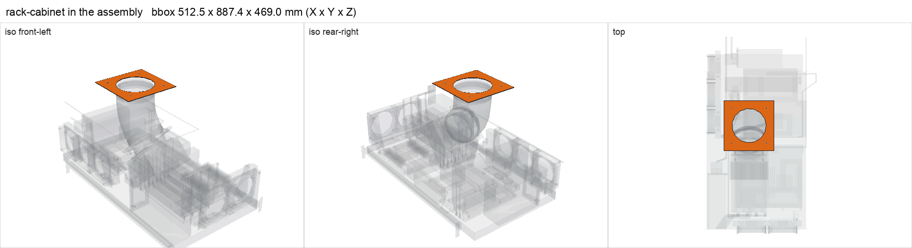

# SysRacks SP 12.900 12U soundproof cabinet (600 x 900)

<!-- Generated by make check from rack-cabinet.toml and the library part.toml. Edit those, not this file. -->

Library spec: [parts/purchased/rack-cabinet](../../parts/purchased/rack-cabinet/README.md) (dimensions, interfaces, datasheets, model).

| | |
| --- | --- |
| Role | cabinet that receives the shelf and the roof exhaust |
| Status | selected |
| Quantity | 1 |
| Systems | rack |

## Assembly

- 1 instances in the assembly

## Compatibility checks

| Status | Rule | Interface | Detail |
| --- | --- | --- | --- |
| BLOCKED | value | `cabinet-front-clearance` | system needs 20.0; provider value unknown |
| BLOCKED | value | `cabinet-height-above-shelf` | system needs 400.0; provider value unknown |
| BLOCKED | value | `cabinet-rear-clearance` | system needs 135.7; provider value unknown |
| BLOCKED | value | `rack-post-depth` | hammond-rsus1931bk1 needs 457.2..711.2; provider value unknown |
| pass | value | `rack-standard` | hammond-rsus1931bk1 needs EIA-310 19 in; provided by rack-cabinet |
| pass | count | `rack-units` | need 6 x rack-units, have 11 |

