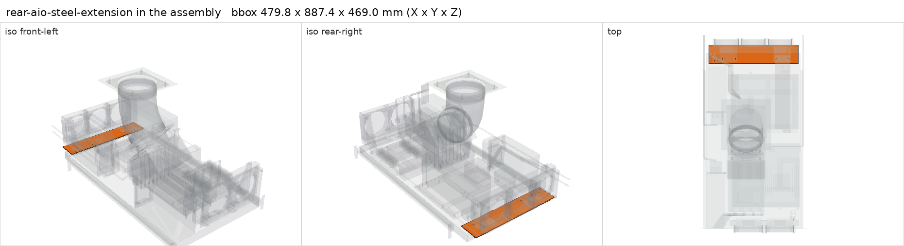

# Rear AIO steel extension plate, 400 x 83 x 3 mm

<!-- Generated by make check from rear-aio-steel-extension.toml and the library part.toml. Edit those, not this file. -->

Library spec: [parts/fabricated/rear-aio-steel-extension](../../parts/fabricated/rear-aio-steel-extension/README.md) (dimensions, interfaces, datasheets, model).

| | |
| --- | --- |
| Role | carries the rear radiator feet beyond the deck |
| Status | design |
| Quantity | 1 |
| Systems | kenshin, shelf |

## Assembly

- 1 instances in the assembly

## Compatibility checks

| Status | Rule | Interface | Detail |
| --- | --- | --- | --- |
| provisional | budget | `shelf-load` | load 23.8 kg of 39.0 kg x derate 1.0 = 39.0 kg (61% of rating) |

