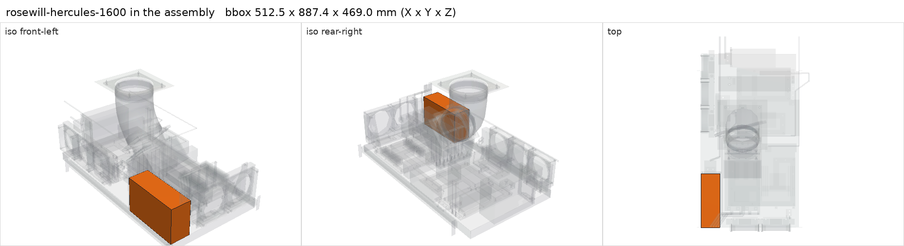

# Rosewill Hercules 1600 W PSU (reused)

<!-- Generated by make check from rosewill-hercules-1600.toml and the library part.toml. Edit those, not this file. -->

Library spec: [parts/purchased/rosewill-hercules-1600](../../parts/purchased/rosewill-hercules-1600/README.md) (dimensions, interfaces, datasheets, model).

| | |
| --- | --- |
| Role | Berserk PSU |
| Status | owned |
| Quantity | 1 |
| Systems | berserk |

## Assembly

- 1 instances in the assembly

## Compatibility checks

| Status | Rule | Interface | Detail |
| --- | --- | --- | --- |
| BLOCKED | budget | `ac-power` | load 2531.0 W; capacity unknown |
| BLOCKED | count | `sata-power` | need 1 x sata-power, have None |
| provisional | count | `atx-24pin` | need 1 x atx-24pin, have 1 |
| provisional | budget | `dc-power` | load 1096.0 W of 1600.0 W x derate 0.8 = 1280.0 W (68% of rating); relies on configured limits of ['nvidia-v100-pcie-16gb']; unlimited peak 1376.0 W |
| provisional | budget | `dc-power` | load 23.2 W of 2800.0 W x derate 0.8 = 2240.0 W (1% of rating) |
| provisional | count | `eps-8pin-cpu` | need 2 x eps-8pin-cpu, have 2 |
| provisional | count | `pcie-8pin` | need 8 x pcie-8pin, have 8 |
| provisional | count | `peripheral-12v` | need 1 x peripheral-12v, have 2 |
| provisional | value | `psu-restraint` | rosewill-hercules-1600 needs ATX 150 x 86 face; provided by psu_bracket |
| provisional | count | `psu-restraint` | need 2 x psu-restraint=atx 150 x 86 face, have 2 |
| provisional | budget | `shelf-load` | load 23.1 kg of 39.0 kg x derate 1.0 = 39.0 kg (59% of rating) |

