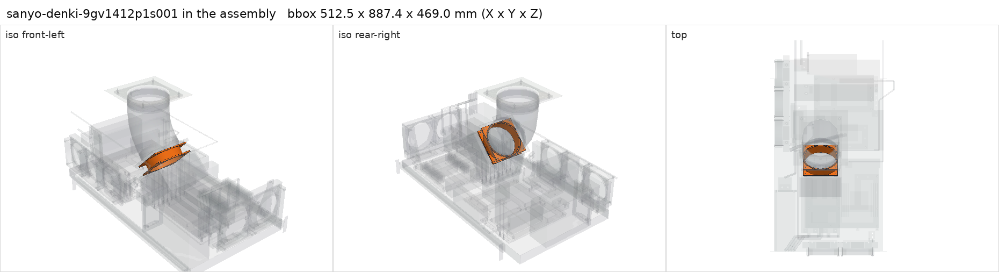

# Sanyo Denki San Ace 9GV1412P1S001 140 x 38 mm fan

<!-- Generated by make check from sanyo-denki-9gv1412p1s001.toml and the library part.toml. Edit those, not this file. -->

Library spec: [parts/purchased/sanyo-denki-9gv1412p1s001](../../parts/purchased/sanyo-denki-9gv1412p1s001/README.md) (dimensions, interfaces, datasheets, model).

| | |
| --- | --- |
| Role | pressure fan pulling air through the four V100s |
| Status | selected |
| Quantity | 1 |
| Systems | berserk |

## Assembly

- 1 instances in the assembly

## Compatibility checks

| Status | Rule | Interface | Detail |
| --- | --- | --- | --- |
| provisional | budget | `dc-power` | load 1096.0 W of 1600.0 W x derate 0.8 = 1280.0 W (68% of rating); relies on configured limits of ['nvidia-v100-pcie-16gb']; unlimited peak 1376.0 W |
| provisional | value | `fan-mount` | sanyo-denki-9gv1412p1s001 needs 140 mm, 124.5 mm pitch; provided by gpu_exhaust_fan_flange, v100_gpu_shroud |
| provisional | count | `fan-mount` | need 2 x fan-mount=140 mm, 124.5 mm pitch, have 2 |
| provisional | value | `fan-power` | sanyo-denki-9gv1412p1s001 needs 12 V PWM 4-wire, 3.1 A; provided by fan-power-harness |
| provisional | count | `fan-power` | need 1 x fan-power=12 v pwm 4-wire, 3.1 a, have 1 |
| provisional | count | `gpu-forced-airflow` | need 4 x gpu-forced-airflow, have 4 |
| provisional | budget | `shelf-load` | load 23.1 kg of 39.0 kg x derate 1.0 = 39.0 kg (59% of rating) |

