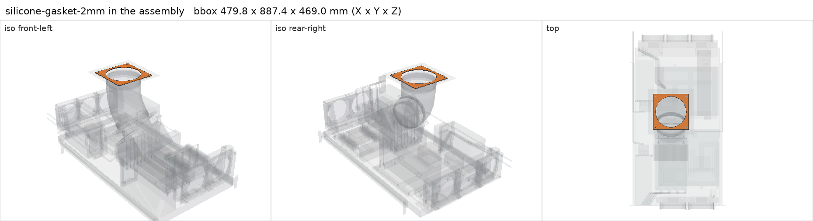

# 2 mm silicone foam gasket sheet, 200 x 200 mm

<!-- Generated by make check from silicone-gasket-2mm.toml and the library part.toml. Edit those, not this file. -->

Library spec: [parts/purchased/silicone-gasket-2mm](../../parts/purchased/silicone-gasket-2mm/README.md) (dimensions, interfaces, datasheets, model).

| | |
| --- | --- |
| Role | roof flange seal |
| Status | candidate |
| Quantity | 1 |
| Systems | berserk |

## Assembly

- 1 instances in the assembly

