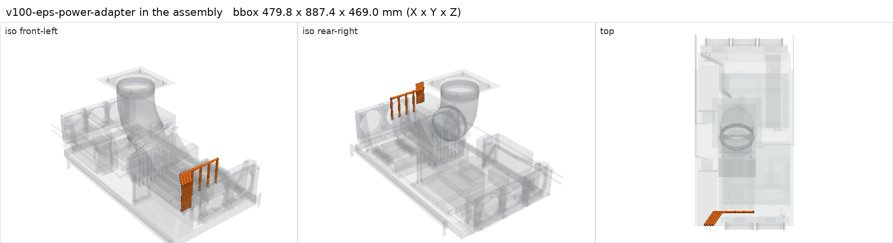

# Dual PCIe 8-pin to CPU/EPS 8-pin GPU adapter (030-0571-000 compatible)

<!-- Generated by make check from v100-eps-power-adapter.toml and the library part.toml. Edit those, not this file. -->

Library spec: [parts/purchased/v100-eps-power-adapter](../../parts/purchased/v100-eps-power-adapter/README.md) (dimensions, interfaces, datasheets, model).

| | |
| --- | --- |
| Role | V100 auxiliary power adapter |
| Status | selected |
| Quantity | 4 |
| Systems | berserk |

## Assembly

- 16 instances in the assembly

## Compatibility checks

| Status | Rule | Interface | Detail |
| --- | --- | --- | --- |
| provisional | count | `pcie-8pin` | need 8 x pcie-8pin, have 8 |
| provisional | budget | `shelf-load` | load 23.8 kg of 39.0 kg x derate 1.0 = 39.0 kg (61% of rating) |
| provisional | value | `v100-aux-power` | nvidia-v100-pcie-16gb needs CPU/EPS 8-pin; provided by v100-eps-power-adapter |
| provisional | count | `v100-aux-power` | need 4 x v100-aux-power=cpu/eps 8-pin, have 4 |

