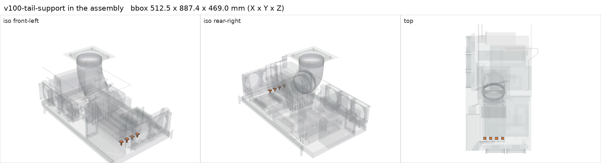

# M4 F/F 20 mm metal spacer with 4 mm silicone pad

<!-- Generated by make check from v100-tail-support.toml and the library part.toml. Edit those, not this file. -->

Library spec: [parts/purchased/v100-tail-support](../../parts/purchased/v100-tail-support/README.md) (dimensions, interfaces, datasheets, model).

| | |
| --- | --- |
| Role | V100 tail support |
| Status | candidate |
| Quantity | 4 |
| Systems | berserk |

## Assembly

- 8 instances in the assembly

## Compatibility checks

| Status | Rule | Interface | Detail |
| --- | --- | --- | --- |
| provisional | budget | `shelf-load` | load 23.1 kg of 39.0 kg x derate 1.0 = 39.0 kg (59% of rating) |

