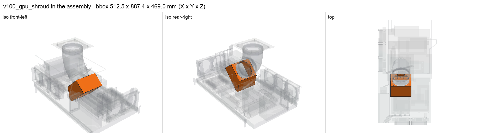

# v100_gpu_shroud

<!-- Generated by make check from v100_gpu_shroud.toml and the library part.toml. Edit those, not this file. -->

Library spec: [parts/printed/v100_gpu_shroud](../../parts/printed/v100_gpu_shroud/README.md) (dimensions, interfaces, datasheets, model).

| | |
| --- | --- |
| Role | hood over the four MI50s with integral 45 degree fan panel |
| Status | design |
| Quantity | 1 |
| Systems | berserk |

## Assembly

- 1 instances in the assembly

## Compatibility checks

| Status | Rule | Interface | Detail |
| --- | --- | --- | --- |
| BLOCKED | budget | `shelf-load` | load 18.2 kg of 39.0 kg x derate 1.0 = 39.0 kg (47% of rating); unknown load for ['amd-instinct-mi50-32gb'] |
| provisional | value | `fan-mount` | sanyo-denki-9gv1412p1s001 needs 140 mm, 124.5 mm pitch; provided by gpu_exhaust_fan_flange, v100_gpu_shroud |
| provisional | count | `fan-mount` | need 2 x fan-mount=140 mm, 124.5 mm pitch, have 2 |

