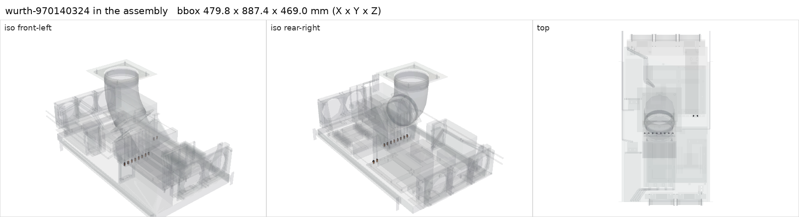

# Wurth 970140324 M3 F/F standoff, 14 mm, SW5.5

<!-- Generated by make check from wurth-970140324.toml and the library part.toml. Edit those, not this file. -->

Library spec: [parts/purchased/wurth-970140324](../../parts/purchased/wurth-970140324/README.md) (dimensions, interfaces, datasheets, model).

| | |
| --- | --- |
| Role | GPU post bases, bearing directly on the steel shelf |
| Status | selected |
| Quantity | 10 |
| Systems | berserk, kenshin |

## Assembly

- 10 instances in the assembly

## Compatibility checks

| Status | Rule | Interface | Detail |
| --- | --- | --- | --- |
| provisional | budget | `shelf-load` | load 23.8 kg of 39.0 kg x derate 1.0 = 39.0 kg (61% of rating) |
| pass | value | `post-base-thread` | obt-pcie-support needs M3 female; provided by wurth-970140324 |
| pass | count | `post-base-thread` | need 10 x post-base-thread=m3 female, have 10 |

