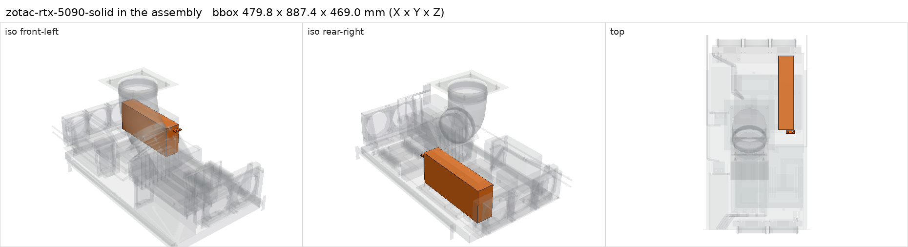

# Zotac Gaming GeForce RTX 5090 Solid 32 GB

<!-- Generated by make check from zotac-rtx-5090-solid.toml and the library part.toml. Edit those, not this file. -->

Library spec: [parts/purchased/zotac-rtx-5090-solid](../../parts/purchased/zotac-rtx-5090-solid/README.md) (dimensions, interfaces, datasheets, model).

| | |
| --- | --- |
| Role | Kenshin GPU |
| Status | owned |
| Quantity | 1 |
| Systems | kenshin |

## Assembly

- 2 instances in the assembly

## Compatibility checks

| Status | Rule | Interface | Detail |
| --- | --- | --- | --- |
| BLOCKED | count | `12v-2x6` | need 1 x 12v-2x6, have None |
| provisional | budget | `dc-power` | load 908.0 W of 1200.0 W x derate 0.8 = 960.0 W (76% of rating) |
| provisional | budget | `shelf-load` | load 23.8 kg of 39.0 kg x derate 1.0 = 39.0 kg (61% of rating) |
| pass | value | `pcie-x16-slot` | zotac-rtx-5090-solid needs PCIe x16; provided by gigabyte-x870e-aorus-pro |
| pass | count | `pcie-x16-slot` | need 1 x pcie-x16-slot=pcie x16, have 1 |

