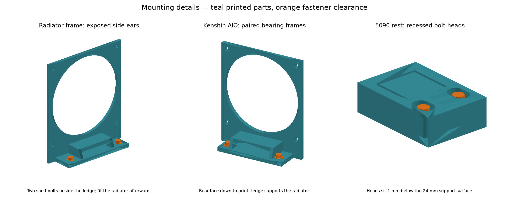

# Assembly guide

This guide covers fastening order, tool access and load paths for the shelf build. The geometry and the reasons behind it are in [design.md](design.md), parts in [PARTS.md](../PARTS.md), and print settings in [printing.md](printing.md).

The build uses 18 printed parts on 14 plates (17 installed plus one T-nut fit coupon) and 39 shelf joints: 25 M4 and 14 M3. Berserk's H12D needs eight standoffs and Kenshin's X870E nine. Before assembly, check three items that are still unverified: the BMC-to-GPU underside clearance, the H115i SP3 fit, and the real projection of the angled EPS extensions.

## What carries the weight

| Component | Load path and restraint | Check before relying on it |
| --- | --- | --- |
| PSUs | The steel shelf carries the weight. The Hercules has 202.5 mm of its 245 mm on steel and overhangs 42.5 mm at the front. Two upper factory screws and the gusseted bracket stop tipping and sliding. | Factory hole pattern, screw engagement, cord clearance. The bracket is not a lifting handle. |
| Motherboards and CPU coolers | Metal standoffs load the 6 mm adapter rails onto the steel. Each section has at least four non-collinear board screws. Three drop-in keys locate the pair in X/Y. Two front bolts and the rear GPU-post joints clamp it down; the keys alone do not hold Z. | Populate only real board holes. Rails must sit flat with loaded standoffs over solid steel, not a large unmeasured opening. |
| H115i (140 mm AIO) | Two broad 6 mm ledges and paired 4 mm side webs per frame carry the radiator. Face screws retain it. The 40 mm feet keep 27 mm of steel bearing with anchors at Y15. The hose brace shares fore/aft hose torque through two rear factory holes and two shelf anchors. | Real tank contact, hose pull, warm PETG stiffness. Both ledges must bear evenly; the screws must not hang the radiator above them. |
| GPU brackets | All ten OBT rod/base joints (eight Berserk, two Kenshin) also clamp the motherboard adapters, each with OD12 backing, a small M3 underside washer and an OD9 top washer. | Survey flange coordinates and both thread engagements. |
| RTX 5090 front end | A 24 mm printed rest carries compression into the deck. Its two bolt heads are recessed below the card. | Touch a rigid shroud or frame surface, clear of fans and PCB. Adjust to the installed card. |
| V100 tails | Four M4 20 mm metal spacers with 4 mm silicone pads under rigid card-frame surfaces. | Fasten from below. Avoid PCB components, hot contacts and heatsink airflow. |
| V100 cooling hood | Integral 10 mm fan panel, 3.2 mm hood and 6 mm base. Three internal M4 anchors carry hood and fan. The duct is supported separately. | T-nut coupon, base and rod clearance, long-driver access through the bare fan opening, inlet seal, loaded HT-PLA-GF stiffness. |
| Lian Li 360 (120 mm AIO) | Two identical frames with broad ledges and tapered webs, four factory radiator screws and two shelf anchors per frame. Three coplanar fans outward with a 6 mm center spacer. A hose brace adds two radiator screws and two shelf anchors. | 38.5 mm rear projection including heads; 80.25 mm nominal clearance to 6U; hose bends, factory threads, PETG temperature, rear lip and door. |

This is a stationary-rack design. The printed parts have no measured strength or thermal-creep rating.

## Fasteners and access

The [access audit](../models/assembly-access-audit.json) checks washer, screw-head and straight-driver envelopes across slot travel. It models straight shafts only, not hands or tool handles, so confirm access on the real hardware. Exact centres and stacks for every joint are in [mount-hole-manifest.json](../models/mount-hole-manifest.json).

**Install covered fasteners first.** Shelf bolts under a PCB, radiator or hood become unreachable once that part is in place.

- **Ordinary printed mounts (M4):** M4 through-bolt, OD12 washers top and bottom, nut. Up to 12 mm OD washers fit everywhere except the 5090 rest. Size bolt length to the real foot, washer and shelf stack.
- **5090 rest:** use **9 mm OD washers**. Washer plus head must be no more than 5 mm tall inside the 6 mm deep, 17 × 12 mm recesses. That leaves 1 mm nominal clearance under the card.
- **Motherboard standoffs:** low-head #6-32 screws go into the 10.8 × 8.5 mm, 3 mm deep underside recesses behind 6 × 3.7 mm through-slots. Check a real screw head before printing both adapter sets. Leave these screws loose and align every standoff to the unpowered PCB using the ±1.15 mm travel. Tighten without flexing the board, then remove the board before mounting the adapters to the shelf.
- **Front motherboard anchors (4):** M3 × 16 with Ø7 × 0.5 mm top and back washers. The heads (Ø6 × 3 mm) stay outside the PCB across the ±2 mm slot travel.
- **GPU post / adapter joints (10), bottom to top:** M3 × 12 → Ø7 × 0.5 washer → Ø12 × 1 backing washer (M4 DIN 9021, OD12/ID4.4) → shelf (1.2 mm nominal) → 6 mm adapter → Ø9 × 0.5 top washer → Würth 970100354 10 mm female/female base → OBT rod. Nominal lower engagement is 2.8 mm. Hold the base's SW5 flats and tighten from below. Check that the backing washer bridges sound steel around the hole or vent, and that the lower screw and the OBT stud do not meet inside the base.
- **V100 tail spacers (4):** M4 from below with a steel washer into the 20 mm female/female spacer.
- **GPU fan:** four M4 × 14 inlet screws, four M4 × 16 outlet screws, eight M4 2020 hammer T-nuts and eight OD9 × 1 washers. Each face clamps only the 4 mm fan flange to a 10 mm printed panel. The 12.2 × 6.4 × 4.8 mm nut pockets are provisional, so print `11_tnut_fit_coupon` first. The hood needs no joining screws.
- **PSU, radiator and fan screws:** length depends on the real component. Add the printed part and washer thickness to the factory screw length; the supplied screws may be too short. Use only existing factory threads and never drill a component. An overlong radiator screw can puncture the core.

## Assembly order

### 1. Survey and dry-place

Fit the empty shelf in the rack. Dry-place the hardware and establish the real board, GPU flange and radiator coordinates before drilling. Check under-shelf access for every washer and nut. Remove electronics before drilling, use real vents where they fit, and deburr every hole.

### 2. Motherboard adapters

Berserk uses `01_atx_mobo_adapter_front` + `03_h12d_mobo_adapter_rail`. Kenshin uses `01_atx_mobo_adapter_front` + `02_atx_mobo_adapter_rail`. The two front sections are identical. The rails are not interchangeable: the H12D rail's post slots are shifted 32.3 mm toward low X.

1. Dry-fit all three keys of each pair. They should drop in freely without force.
2. Fit the underside standoff screws on the bench. H12D: A/C/F/G/H/K/L/M only, four per section, **no standoffs at B or J**. Kenshin: four and five, with B only if the PCB has that hole.
3. Lay the pair flat on the steel and seat the keys.
4. Fit the front M3 × 16 anchors with Ø7 × 0.5 washers through sound steel: **Berserk X355 / 434, Y63.70; Kenshin X224 / 303, Y374.00**. The 8 × 4 mm slots give ±2 mm adjustment. Re-mark positions from the real board and the manifest.
5. Choose the rear post slots from the seated cards. Default posts are **Berserk X128.58 / 148.58 / 169.22 / 189.22 / 209.86 / 229.86 / 250.50 / 270.50, Y320.20; Kenshin X51 / 71, Y634.50**. Drill Ø3.5 mm through the clamped bare adapter's slots. Unused slots need no hardware. See the [clamp diagram](../models/pcie-post-shared-mount.png).
6. Optional: each board has six inner 8 × 4 mm M3 slots. Fit any chosen M3 × 16 bolts, Ø7 washers and nuts now, before the PCB covers them. These are not part of the 39 default joints.

The 6 mm rear rail sits 4.5466 mm below a conservative I/O shield edge. Tall high-X posts and real plug bodies still need a dry fit.

### 3. Under-shelf metal supports

1. Fit the four M4 20 mm V100 tail spacers from below with steel washers at Y57.5, X263.5 / 222.86 / 182.22 / 141.58, before the cards go in.
2. Fit the ten GPU-post joints: backing and small M3 washers below the shelf, the 10 mm female/female bases above. Tighten the M3 × 12 screws from below while holding the bases' wrench flats.
3. Fit the OBT rods and cards later, after checking rod height and threads.

### 4. RTX 5090 rest

Bolt `04_gpu_rest` down at X53 / 83, Y344.25 before fitting the GPU. Both heads and washers must sit below the top contact surface. The rest at X43–93 leaves 2.08 mm nominal clearance to the V100 hood and 6 mm board margin to the shelf edge; check real lips and components. Fit the board and GPU, then adjust the support height so it holds the card without pushing it out of its slot.

### 5. Berserk front AIO (H115i, 140 mm)

1. Bolt the two bare `06_fan140_aio_frame` feet to the shelf at **X162 / 254 / 302 / 394, Y15** first. The radiator blocks the screwdriver path once fitted. With the frame faces about 13 mm ahead of the shelf edge, each foot keeps 27 mm on steel. At full ±2.5 mm slot travel the OD12 washers keep 6.5 mm from the front edge. If the sandwich is already assembled, take it apart for bolt access.
2. Seat the radiator on both ledges with the fans in front and the frames between. Eight shared screws pass through fan and frame into the factory radiator threads. Allow for the 5 mm frame, real head seats and washers while keeping safe engagement.
3. Check that the fan arrows point toward the rack rear.
4. Fit `07_fan140_aio_hose_brace` while supporting the AIO. The brace's inward web covers the frame bolts' top access, so make sure they are already tight.
   - Attach its 6 mm flange loosely to the two unused rear radiator holes at X410.25, Z27.75 / 152.25, using matching factory-thread screws and OD10 washers. Do not use an overlong fan screw.
   - Mark the two shelf slots at **X410.25, Y38 / 53.5**. Check the real vent, lip and under-shelf access, then fit two M4 bolts, two nuts and four OD12 washers. The slots allow ±1.5 mm; at opposite travel extremes the OD12 washers keep 0.5 mm apart.
   - The brace foot runs Y29–62.5, 6.70 mm ahead of the board. Its front web rises to Z13 to clear the frame foot and bolt head.
5. Check the hose elbows, relax the hose loop and tighten without drawing the radiator into position. The brace and frames must share the restraint without stressing the pump or board. See the [brace detail](../models/fan140-aio-hose-brace.png).

### 6. PSU brackets

1. Anneal the two `psu_bracket` prints (`05_psu_brackets`), let them cool, then check dimensions ([printing.md](printing.md)).
2. Mark the shelf anchors: **Berserk X31 / 55, Y221.5** (PSU body X0–86); **Kenshin X366 / 390, Y564.5** (PSU body X335–421).
3. Fit M4 through-bolts with OD12 washers and nuts, sized to the 6 mm foot and the real shelf stack. Leave them loose.
4. Align the two upper factory screws in the 5 × 4 mm slots. The rear face is 9 mm thick, so allow for it and the washers while keeping safe factory engagement. Do not force the slots or pull the PSU into alignment.
5. Check that the AC plug seats fully under the 8 mm top bar, that the LED (if any) clears the 9 × 40 mm relief, and that cables can reach. Then tighten and route the cords.

### 7. Kenshin rear AIO (Lian Li 360, 120 mm)

1. Bolt the two bare `08_fan120_aio_frame` feet at **X65 / 141 / 305 / 381, Y678.5** on sound steel with OD12 backing. Tighten these before the radiator goes in: it covers the driver paths, and the brace also limits access to the rightmost bolt.
2. Rest the radiator on both Z20 ledges.
3. Fit `10_fan120_aio_center_spacer` (119 × 119 × 6 mm) and all three fans outward on the Y706.5 plane. Twelve matching factory-thread screws hold fans, frames and spacer. Keep the original safe engagement while adding 6 mm plus any washer thickness.
4. Fit `09_fan120_aio_hose_brace` loosely on the inward radiator face at X395.5, Z27.5 / 132.5 with two matching screws and OD10 washers. Its low-X web points away from the right hose end.
5. Mark the brace shelf anchors at **X395.5, Y638 / 653.5**. Fit two M4 bolts, two nuts and four OD12 washers sized for the 8 mm foot. Tighten without preloading the hoses.
6. Check the 2.75 mm nominal gap to the frame, the real hose elbows, the pump routing and warm PETG stiffness. Fit the pump with the original AM5 hardware and broad hose bends. Rear screw heads project 38.5 mm past the shelf. See the [frame and brace detail](../models/fan120-aio-frames-and-brace.png).

### 8. V100 hood and fan

1. Print `11_tnut_fit_coupon` in HT-PLA-GF to test the T-nut pocket. Then print `12_v100_gpu_shroud` fan-face down, without removable supports. Keep its four 4 mm chamber ribs and inspect their roots, the wall transitions and all slots.
2. Tighten Kenshin's front motherboard anchors now; the hood covers their driver paths.
3. Load the four inlet T-nuts from inside the empty hood.
4. Lower the bare hood over the rear of the GPU array. Its base occupies **Y333–363, Z0–6**, with ground contact at Y339–363 after the front bevel. That is 2.3 mm clear of the adapter rail and 17.5 mm from Kenshin's PCB (about 1.7 mm to its adapter ears).
5. Transfer the three slots, **X147.54 / 257.54 at Y347 and X202.54 at Y352.5**, onto sound steel, reusing vents where possible. Fit three M4 × 16 bolts, three nuts and six OD12 × 1 washers; confirm length on the real shelf. Tighten them with a long driver through the bare fan opening **before** fitting the fan or outlet flange.
6. Seal the common lower opening and the inlet perimeter with secured, nonconductive flexible foam or tape. Keep vents open and keep material away from the rotor. Do not lever against GPU PCBs.
7. Fit the fan with the four M4 × 14 inlet screws and OD9 washers. Use a long 3 mm hex bit through the opposite factory holes.

The fan top is at Z233.44, 11.19 mm above nominal 6U. Keep the space above it clear for the duct.

### 9. Exhaust duct

1. Dry-fit `13_gpu_exhaust_fan_flange` and the real Kenshin 24-pin cable. The rigid parts clear the modeled cable reserve, and the hose route can be adjusted. Keep the space up to the inner ceiling at Z400 clear.
2. Load four M4 hammer T-nuts into the outlet flange's open pockets. Fit it with four M4 × 16 socket caps and OD9 × 1 washers through the fan's open corners, using a short 3 mm hex key. The inlet screws must already be tight, because the outlet hardware blocks their driver paths. Seal the mating seam.
3. Survey the inner ceiling and roof chamber. Place the 154 mm opening and four corner anchors on sound sheet, away from factory fans, wires and ribs. Remove and deburr the panel for cutting so chips cannot reach electronics. Fit `14_gpu_exhaust_roof_flange` with the 2 mm gasket, four M4 × 20 bolts, four nuts and eight OD12 × 1 washers, sizing bolt length to the real stack. The roof flange has 8 × 5.5 mm adjustment slots. Do not cut the outer lid.
4. Slip the 6-inch wire-supported duct over both necks. Put one McMaster 53185K52 lever clamp at each end, fully over supported neck material. The fan neck is only 28 mm long: centre the 22.225 mm band and check full cuff insertion. Tighten enough to seal without ovalizing the neck.
5. Route the duct around components without pushing on RAM, connectors, hoses or fan inlets. Hang its weight from rack structure with a strap and leave a service loop. With GPU load stopped, test that each cuff comes off before trimming the duct. Leave the roof flange installed for service.

### 10. Final mechanical check

Move each part by hand: nothing should rock. No board should be bent by mismatched supports. Radiator and GPU weight should rest on the intended bearing surfaces. Never tighten a screw to pull a misaligned part into position. After sustained operation, recheck printed parts for movement or softening and fasteners for loosening.

## Fan wiring and first power-up

- Power the Sanyo Denki fan from the PSU through a controller rated for 3.1 A plus a verified startup allowance, not from a motherboard header. Leads: red +12 V, black ground, yellow tach, brown 25 kHz PWM. An open PWM line runs the fan at full speed, and 0% duty stops it.
- Configure full speed at startup and on faults. Control from the hottest GPU, and stop GPU load if tach is lost. Keep leads and seals away from the rotor.
- Check the V100 power adapters' pinout before connecting: the cards take CPU/EPS 8-pin wiring. Never plug a PCIe 8-pin directly into a V100.
- Start at about **180 W per V100** with the fan at full speed. Measure GPU / HBM, hood, base and fan-panel temperatures with the cabinet closed. A loaded printed surface at 50 °C is an inspection trigger, not a rating. Stop for softening, creep, looseness, fan failure, duct collapse, backflow or a loosening joint. Raise power only after a stable sustained test and reinspection.
- Check Berserk's total draw against the PSU and any UPS.
- Test exhaust performance with the roof chamber open to its factory outlets. The pressure fan and the roof fans do not have additive CFM ratings.

The angled EPS projection and BMC/GPU underside clearance remain open physical checks; see [design.md](design.md#physical-release-checks).
