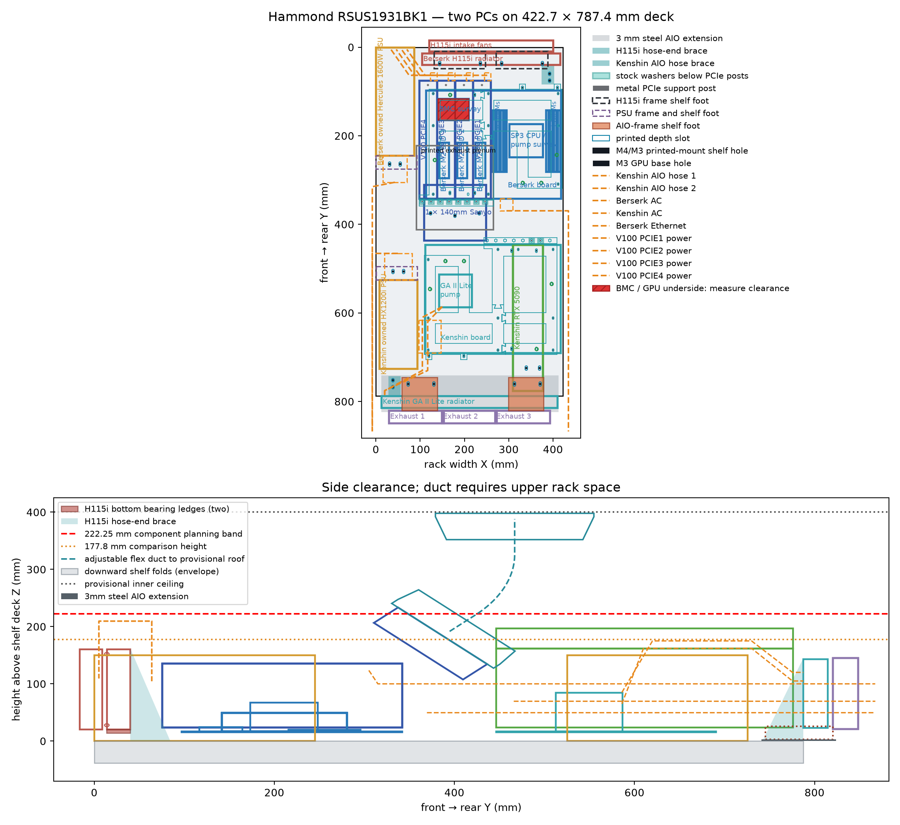

# Design: two PCs on a sliding shelf

Berserk and Kenshin use a **Hammond RSUS1931BK1 solid sliding shelf with its supplied slides**, selected by the owner on 2026-11-05. This replaces the StarTech ADJSHELFHDV / King Slide adaptation and all rail shims. Purchase and physical fit are not confirmed.

| System | Components |
| --- | --- |
| Berserk | HUANANZHI H12D-8D + BMC, AMD EPYC 7702P (64 cores / 128 threads, 200 W), 8 × 32 GB Micron DDR4-2933 ECC RDIMM, four NVIDIA V100 PCIe 16 GB, 2 × 2 TB Micron 3400 + 1 × 2 TB Micron 3500 NVMe (RAID 0), Corsair H115i (front, 140 mm fans), Rosewill Hercules 1600 W PSU |
| Kenshin | Gigabyte X870E AORUS PRO, AMD Ryzen 9 9950X3D, Zotac RTX 5090, Lian Li GA II LITE Performance 360 (rear, 120 mm fans), Corsair HX1200i |

Networking uses each board's onboard Ethernet (Berserk: two Intel I226-V 2.5GbE ports plus the dedicated BMC port; the I226-V has no BMC sideband, so the BMC needs its own cable). The full parts list is in [parts.xlsx](../parts.xlsx); assembly steps are in [assembly.md](assembly.md); print settings and materials are in [printing.md](printing.md).

**Berserk memory.** The owner confirmed the [Micron 256 GB kit](https://www.ebay.com/itm/377566838345) as ordered on 2026-11-04. It contains eight used, matched 32 GB DDR4-2933 ECC Registered RDIMMs, part MTA36ASF4G72PZ-2G9E2UI, 2Rx4, 1.2 V. Fit one DIMM per channel. This replaces the earlier 8 × 16 GB DDR4-3200 plan. Installed 2026-11-07: all eight report Micron 36ASF4G72PZ-2G9E2 in SPD and run at 2933 MT/s, one per channel. ECC is active with no errors at first boot. A full memory test is pending; the paid price was not provided.

**Berserk storage.** Three used 2 TB M.2 2280 PCIe 4.0 ×4 NVMe SSDs were ordered on 2026-11-04 as Dell Micron 3400s (MTFDKBA2T0TFH, DP/N 0VX5CD) from [LA-Tronics' eBay listing](https://www.ebay.com/itm/880020201442) at $205.95 each. Installed 2026-11-07, the drives identify as two Micron 3400s ([micron-3400-2tb](../parts/purchased/micron-3400-2tb/README.md): MTFDKBA2T0TFH-1BC1AABHA with HP firmware, and a Micron-firmware 3400) and one Micron 3500 ([micron-3500-2tb](../parts/purchased/micron-3500-2tb/README.md): MTFDKBA2T0TGD-1BK1AABHA, HP firmware). All three link at PCIe 4.0 ×4, and SMART on 2026-11-07 shows 0% used, 100% spare and no media errors (30–559 power-on hours). **Boot layout:** the EFI system partition is only on the HP-firmware 3400 (`nvme0`). Everything else, including the OS, is XFS on a 5.6 TB md RAID 0 across all three drives (512 KiB chunk), with no redundancy: losing one drive loses the OS and data, so keep anything that cannot be downloaded again backed up elsewhere. Measured sequential O_DIRECT throughput (8 threads, 32 GiB) is **17.5 GB/s read and 12.7 GB/s write**. On the bare board the two 3400s idle at about 50 °C and reach 58 °C after a short burst, while the 3500 idles at about 39 °C. SSD cooling and clearance beneath the V100s remain provisional and require a physical check; they are not validated by the current CAD envelopes.

Every part has a folder under [parts/](../parts/README.md) with its evidence-tagged spec, datasheet links, model and renders; [process.md](process.md) describes the workflow and [system-check.md](system-check.md) the current compatibility results.

This remains a fit prototype. Manufacturer dimensions, photograph estimates, owner measurements and design allowances are separate evidence classes. CAD validates the modeled shapes and checks, not the unmeasured real interfaces. Printed mounts have no measured load or thermal-creep qualification.

## Shelf and layout

The [current Hammond table](https://www.hammfg.com/dci/products/accessories/rsus) specifies:

| Property | Value |
| --- | --- |
| Deck width × depth | 16.64 × 31 in = **422.656 × 787.4 mm** |
| Increase in depth / decrease in width | **87.4 mm deeper / 23.344 mm narrower** than the former shelf |
| Slide travel | 28 in = 711.2 mm |
| Front-to-rear rack-post mounting range | 18–28 in = 457.2–711.2 mm |
| Equipment load limit | 85 lb / 39 kg |
| Shelf mounting / clearance | 2U mounting; 3U required clearance for shelf alone |
| Downward fold height / overall assembly height | 38.1 / 68.072 mm |
| Overall width | 479.806 mm |
| Material | 16-gauge steel; CAD uses **1.52 mm nominal thickness**, to be measured |

The [individual drawing](https://www.hammfg.com/files/parts/pdf/RSUS1931BK1.pdf) says 120 lb and 8–28 in, conflicting with the current series table. Use the more restrictive **39 kg and 18–28 in** values until Hammond confirms otherwise. The drawing shows downward folds on all four sides. Slide closed length/cross-section, bracket placement, bend radii and flat bearing area are unmeasured; the STEP uses illustrative envelopes, not factory CAD. The 28 in travel is not a verified closed-rail length. Follow [Hammond’s installation bulletin](https://www.hammfg.com/files/parts/bulletins/BUL87361.pdf?v=1697661758).

Coordinates are millimetres: X left to right viewed from rack front, Y front to rear, Z above the deck. The shelf is X0–422.656, Y0–787.4.

- **Berserk:** board X113–418, Y97.2–342.2. Hercules PSU X0–86, Y0–245, fully on steel. Front H115i radiator Y14–40; fans Y−16–9. Its original mount geometry is reused with the new placement.
- **Kenshin:** board X111.656–416.656, Y446.5–690.5, turned 180°. Rear I/O faces the center corridor; the GPU sits at high X opposite the hood. The PSU is X7.656–93.656, Y525.5–725.5, inlet facing front.
- **Working clearance:** nominal V100 hood to RTX 5090 lateral gap is **43.656 mm**, previously 2.08 mm. GPU tail to rear board gap is **104.3 mm**. A full **40 mm approach reserve** for Kenshin’s inward-facing I/O is checked against the hood. Exact plugged connector shapes still require a dry fit.
- **Rear AIO:** radiator Y787.5–814.5; fans Y820.5–848.5; nominal screw heads to Y852.5 (**65.1 mm beyond the deck**). The steel extension, extended feet and compact GPU rest are described below. Reserve another 35 mm behind screw heads for straight-driver access during installation.
- **Height:** the 222.25 mm component planning band is not a total rack-height claim. The pressure fan reaches Z233.439 and the fixed exhaust roof is provisionally Z400; lower shelf/slide geometry and rack alignment also consume space. Measure the actual cabinet before assigning U positions.

The narrower deck leaves 4.656 mm at Berserk’s right board edge and 6 mm at Kenshin’s. The Hercules fan faces the V100s across an **11.58 mm nominal lane**, down from 35.58 mm; this is an unresolved airflow constraint. Kenshin’s PSU fan faces the cabinet side; its 7.656 mm deck margin does not establish cabinet-wall intake clearance. The solid shelf has no deck ventilation. Qualify both systems under concurrent load.

## Sliding service and load

**Power down and disconnect fixed-rack power/data and the roof duct before extending.** No cable carrier or live-service slack loop has been designed for the 711.2 mm travel. Shelf-mounted wiring must be secured within the moving assembly; the roof flange stays fixed. Support and reconnect the duct without loading the printed fan panel. Leave the cabinet’s roof outlets open.

The generator checks all explicit underside hardware against the fold/slide envelopes and conservative travel sweeps against the illustrative outer rails/brackets. These checks exclude real rack posts, door geometry, bearing races and latches. Confirm empty travel first, then verify the actual total moving equipment mass is below the applicable rating and follow the rack’s stability/anchoring instructions. Do not treat an open shelf as a workbench or add body weight to it.

## Generated files

`cad/` is the source of truth. Run `make cad plates`, then `make gcode` with OrcaSlicer installed. G-code is not committed.

| File | Contents |
| --- | --- |
| [dual-pc-hammond-assembly.step](../models/dual-pc-hammond-assembly.step) | Complete assembly with illustrative factory slides |
| [rsus1931bk1-drill-plan-deck.step](../models/rsus1931bk1-drill-plan-deck.step) | Solid deck with 45 proposed component mounting holes |
| [rsus1931bk1-solid-deck.step](../models/rsus1931bk1-solid-deck.step) | Undrilled dimensional deck envelope |
| [rear-aio-steel-extension-drill-plan.step](../models/rear-aio-steel-extension-drill-plan.step) | Fabricated 400 × 83 × 3 mm steel extension, six Ø5 holes |
| [hammond-shelf-report.json](../models/hammond-shelf-report.json) | Sources, specification disagreement and model limits |
| [fit-report.json](../models/fit-report.json) | Installed coordinates, components, cables and clearance checks |
| [mount-hole-manifest.json](../models/mount-hole-manifest.json) | Proposed drill positions and factory-interface references |
| [assembly-access-audit.json](../models/assembly-access-audit.json) | Slot travel, washer/head and driver checks |
| [gpu-exhaust-report.json](../models/gpu-exhaust-report.json) | Fan, duct and roof interfaces |

There are 17 installed printed pieces plus one T-nut coupon on 14 plates. Identical copies share a model. Retired shim and shelf-conversion outputs are removed by the generators; older revisions remain in Git history.

## Motherboard adapters

Each board sits on a pair of flat 6 mm printed sections with 25 mm rails:

| Plate | Model | Use |
| --- | --- | --- |
| `01_atx_mobo_adapter_front` | `atx_mobo_adapter_front` | Front section, one per board (print 2). Two M3 front ears. |
| `02_atx_mobo_adapter_rail` | `atx_mobo_adapter_rail` | Kenshin rear rail, eight regular hex holes at provisional post positions. |
| `03_h12d_mobo_adapter_rail` | `h12d_mobo_adapter_rail` | Berserk rear rail, eight regular hex holes aligned with the four V100 post pairs. |

Three broad drop-in dovetail keys locate each pair in X/Y. They do not retain Z: brass standoffs and shelf fasteners do. Each section carries at least four non-collinear board screws.

**Standoffs.** Keystone 1451B #6-32 brass standoffs (9.525 mm) put the PCB underside at Z15.525. The H12D uses eight populated holes, A/C/F/G/H/K/L/M; **do not fit standoffs at B or J**. Kenshin uses nine, with B optional only if the delivered PCB has that hole. That is 17 required standoffs. The adapters keep the unused B/J slots. Low-head #6-32 screws sit in 10.8 × 8.5 mm elongated, 3 mm deep underside recesses behind 6 × 3.7 mm through-slots, giving ±1.15 mm depth travel. Check a real screw head before printing.

The ATX pattern uses 72.39 mm between the middle and far mounting rows. This value was confirmed by the owner's fit measurement.

**Rear rail.** A continuous 25 mm deep rear rail gives eight selectable **regular hexagonal holes, 5.8 mm across flats**, for the SW5.5 GPU bases. Each face has **0.15 mm nominal clearance** for a snug fit. There is no added adjustment travel. Hole centres are now aligned with the existing modeled post axes rather than the former common slot centreline; those axes remain provisional survey coordinates, not standardized flange dimensions:

- H12D: board-local X−8.42 / 11.58 / 32.22 / 52.22 / 72.86 / 92.86 / 113.50 / 133.50, **Yrear+6 mm**.
- Kenshin: board-local X23.88 / **45 / 65** / 84.52 / 105.16 / 125.16 / 145.80 / 165.80, **Yrear+10 mm**. The two populated holes move from the former slot centres X44.44/64.76 onto the unchanged post axes X45/65.

Point one hex corner toward the motherboard. This orientation keeps the hole a true regular hexagon and lets the H12D forward tips meet the GPU groove, avoiding a 0.1 mm wall that would result with a flat facing the groove. Kenshin holes remain separate from the groove. The outer rail dimensions and independent anchors are unchanged. Hold the exposed base with a 5.5 mm wrench while tightening either screw or rod. Only selected holes need hardware. Print one of each rail and check the snug fit after removing brim/first-layer excess; do not force the base into the print. Confirm that the fixed hole centres match fully seated cards and that every base bears fully on real solid steel before drilling.

**GPU bracket-tab groove.** Both rear-rail variants have a simple **2 mm-deep × 2 mm-wide rectangular groove spanning 1–3 mm behind the motherboard rear edge** (centre +2 mm). The groove leaves a 4 mm base. It meets the forward tips of the H12D hex holes; Kenshin holes sit farther back and remain separate. The lower 4 mm preserves each complete regular hex profile. The old post-washer lands are removed because the metal bases no longer clamp the plastic. Motherboard standoff seats remain intact.

The position uses the original standard drawings, not photo scaling. [Intel ATX 2.2, Fig. 3, p. 12](https://analytika.sk/fileadmin/user_upload/developer_specs_atx2_2.PDF#page=12) places the mounting-hole datum 0.400 in (10.16 mm) inside the rear PCB edge. [PCI-SIG PCIe CEM 2.0](https://tecsmith.github.io/homeassistant-pc-switch/specs/pci-express-card-electromechanical-specification-revision-2.pdf#page=97), Figs. 5-1/5-2 and 6-14, locates the connector key 46.94 mm inward from that datum; Fig. 6-2 places the bracket's outside flat face 59.05 mm behind the key. Thus the nominal outside face is **59.05 − 46.94 − 10.16 = 1.95 mm behind the PCB edge**. Fig. 6-4 specifies 0.86 mm sheet and a 5° ±2° outward bend over the last 5.07 mm. Nominally, the straight metal occupies +1.09…+1.95 mm and the tip about +1.53…+2.39 mm. The selected +1…+3 mm groove covers this nominal fore/aft envelope. These are original Intel/PCI-SIG documents hosted on mirrors; the [PCI-SIG publication entry](https://pcisig.com/PCIExpress/Specs/CEM/CardElectromechanical_2.0) identifies the specification.

The rails keep the **original print orientation: screw-head recesses up, groove toward the bed, no supports**. The groove's two walls start on the bed; its roof closes across a 2 mm span at print Z2. The screw pockets remain open upward. Review the generated [ATX](../models/atx_mobo_adapter_rail-print-review.png) and [H12D](../models/h12d_mobo_adapter_rail-print-review.png) print views and inspect the sliced groove closure before printing.

The 2 mm depth is the owner's requested allowance; the 2 mm width and rounded +2 mm centre are design allowances around the standard nominal geometry, not standard-mandated groove dimensions. They do not guarantee the full tolerance stack, connector play or every GPU bracket variant. The photo does not measure the actual tongue geometry or required depth. **Physical fit remains provisional:** check that every seated card's tongue enters the narrow groove and clears its floor and the metal bases. The selected H12D/V100 and Kenshin/5090 interfaces need their own dry fits.

The base bodies still constrain lateral tab fit. Their axes remain survey estimates, and the selected H12D/V100 and Kenshin/5090 interfaces require dry fits. At the H12D groove/hex intersections, inspect newly starting perimeter paths at print Z2.2; the groove is 2 mm wide; angled sliced paths may span farther.

**Prototype audit, 2026-10-23.** The snug regular-hex revision passed CAD assertions, plate generation and all 14 support-free Orca slices. The independent audit verified all 16 lower-4-mm cavities against a separately constructed regular 5.8 mm-AF hex rotated 30°, full-height clearance at their fixed centres, and exact alignment of all ten selected post axes. Both rails remain valid single solids, all six rear-anchor 4 mm webs are complete, and the common front part is unchanged. Six-direction whole-part views, all 16 hex neighborhoods, 14 groove gaps, four groove ends and the groove/counterbore layer transitions were reviewed. No thin 0.1 mm wall, floating start or isolated loop was found. The roof areas match the independent formulas: 330.58 mm² ATX and 336.10 mm² H12D. At the Z2.2 closure, the largest straight roof span is 4.02 mm; accounting for earlier paths, sampled unsupported runs peak at 3.51 mm for walls and 3.07 mm for bridges (0.08 mm maximum sample spacing, 0.45 mm centerline contact criterion). These short connected closures pass prototype print review; final plate/G-code/profile hashes matched. Verify actual snug fit after brim cleanup, fixed post locations, steel bearing, fixed OBT nut height and thread seating on real hardware before printing more copies.

**Front ears.** 14 mm wide with 8 × 4 mm slots (±2 mm depth travel), M3 × 16 bolts and Ø7 × 0.5 mm top and back washers on sound steel. Common ears at local X218/297 clear Berserk's AIO brace.

**Rear-section anchors.** Three mandatory M3 × 16 bolts per rear section secure it independently of the GPU posts. Two new 8 × 4 mm slots sit at board-local X54.2/110, Yrear−13; a third at X110, Yrear−234.49 replaces the former optional X94.84 slot, placing its small washer clear of the other hardware. Use Ø7 × 0.5 top/back washers and nuts on sound steel. Their heads top at Z9.5, below the PCB at Z15.525. Fit these before the motherboard. Together with the front ears, this gives five shelf anchors per board.

**Optional inner anchors.** Five additional 8 × 4 mm slots per board remain optional and excluded from the default drill plan. Use the same M3 hardware and install before the PCB covers them.

**I/O shield.** The ATX datum puts the conservative lower shield edge at Z10.5466, which leaves 4.5466 mm above the 6 mm rail. That is a rail allowance only. Some Kenshin high-X post positions fall inside the shield projection, and plugged-in cables are not checked. Dry-fit the seated cards, ports and plugs before choosing post holes.

## GPU posts and rests

Ten Open Benchtable PCI-E rods (eight Berserk, two Kenshin) seat on **Würth 970140324**, M3 female/female, 14 mm tall, SW5.5 bases. They pass freely through the regular hex openings and bear directly on steel. Hold the exposed flats with a wrench; do not torque against plastic. Selected post coordinates follow the turned board and appear in the manifest.

**Each lower stack:** M3 × 8 screw → **two Ø7 × 0.5 mm washers** → **two Ø12 × 1 mm backing washers** → nominal **1.52 mm steel** → 14 mm metal base → OBT rod. No upper washer; GPU loads bypass the plastic. Ten bases require ten M3 × 8 screws, twenty small and twenty large underside washers, separate from the adapter anchors.

The [Würth drawing](https://www.we-online.com/components/products/datasheet/970140324.pdf) specifies 14 mm M3 internal thread. The OBT stud’s **9 mm thread is owner-reported**, not a published drawing dimension. Nominal lower engagement is **8 − 1.52 − 2 − 1 = 3.48 mm**, leaving **14 − 9 − 3.48 = 1.52 mm** between screw tips. Measure actual steel, washers and screw lengths. Do not reuse the old lower screw selection without recalculating the stack.

The rod seat remains Z14. The fixed lower OBT nut must meet the GPU flange with the card fully seated; never pull a card into position with the retaining nut. The 131 mm rod body and flange positions remain survey envelopes.

**V100s:** four nominal 40 mm cards on 40.64 mm pitch leave only 0.64 mm between cards. NVIDIA’s [dimensioned brief](https://www.nvidia.com/content/dam/en-zz/Solutions/Data-Center/tesla-product-literature/Tesla-V100-PCIe-Product-Brief.pdf) establishes 266.7 × 111.15 mm bodies; thickness, slots, flange holes and installed underside are provisional. Remove shipping extenders. Each tail uses an M4 female/female 20 mm metal spacer and a 4 mm silicone pad, fastened from below. Pads must touch rigid card frames clear of PCB components and airflow.

**RTX 5090 rest:** a revised **50 × 42 × 24 mm** block at X329.656–379.656, Y695–737 fits between the board and longer rear AIO feet. Two M4 anchors have 17 × 12 × 6 mm head recesses. Use Ø9 mm washers and ≤4 mm heads, total ≤5 mm above the recessed seat. A 32 × 13 × 1.5 mm contact relief retains at least 4 mm of material to the screw recesses; test the actual shroud contact and fan clearance.

**BMC underside remains unresolved:** the provisional H12D BMC envelope overlaps two simplified V100 bodies by 0.125 mm. This is neither a verified fit nor a confirmed real collision. Inspect the actual BMC, headers, NVMe cooling and card undersides before assembly.

## PSU bracket

Both PSUs use the same printed bracket, `psu_bracket`, two copies on plate `05_psu_brackets`. The steel shelf carries the PSU weight. The bracket restrains the PSU sideways and against tipping. It is not a lifting handle.

- Fits the 86 × 150 mm ATX PSU rear face, with uniform 9 mm thick rear faces and a continuous lower rail.
- **8 mm top bar.** The owner measured the power connector more than 10 mm below the PSU top, which leaves at least 2 mm nominal clearance. Confirm the molded plug seats fully.
- **9 × 40 mm LED relief** for the Hercules side LED (centre about 80 mm across and 60 mm down from the PSU top, estimated from photographs). An 8 mm bypass web extends 6.5 mm past the 86 mm PSU face, so the maximum width is 92.5 mm. It does no harm on a PSU without a side LED.
- The two upper factory screws pass through 5 × 4 mm vertical slots with at least 4 mm side and 3.5 mm top material. Use washers and verify safe factory thread engagement.
- **Feet:** 50 × 30 × 6 mm with two tapered side gussets. There are two 10 × 5.5 mm shelf slots side by side, 19 mm behind the rear face, with 6 mm of plastic beyond each slot end.

Both PSUs rest fully on steel. Kenshin’s PSU and bracket turn 180° in the deck plane, so its AC inlet faces the central service area and its fan faces the cabinet’s left side. Installed hole coordinates are in the generated manifest.

Use M4 through-bolts, OD12 washers and nuts. The brackets are printed in HT-PLA-GF and annealed (see [printing.md](printing.md)). Check AC plug insertion, LED clearance and cord routing during the dry fit.

## Front 140 mm AIO

The existing H115i mount shapes are reused: fans → 5 mm frames → radiator, with intended airflow toward rack rear. Frames sit at Y9; the 40 mm feet lie fully on the deck at Y9–49, anchors Y37. The radiator rests on 6 mm ledges at Z20, with paired 4 mm side webs; eight screws pass through the fan/frame stack into factory radiator threads. Frames are 140 × 160 mm with 124.5 mm screw pitch and 7 × 4.5 mm slots.

The 162 mm hose brace retains its 8 mm web, 6 mm face and 8 mm foot. It attaches to two unused rear radiator threads and two shelf bolts; fit it without hose preload. The brace ends Y84.5, 12.7 mm ahead of Berserk’s board. Actual factory screw threads/engagement and hose tank clearance are unmeasured. On the EPYC the H115i mounts with an Asetek TR4/SP3 bracket ([asetek-tr4-bracket](../parts/purchased/asetek-tr4-bracket/README.md)); SP3 and TR4 share the four-post cooler mount. The round cold plate covers only part of the 58 × 75 mm SP3 heat spreader, which the owner accepted on 2026-11-06: watch all-core CPU temperatures and move to a full-coverage TR4/SP3 cooler if it throttles. Confirm the bracket lists this pump revision, the mounting pressure and relaxed hose reach.

## Rear 120 mm AIO

The [Lian Li GA II LITE Performance 360](https://lian-li.com/product/ga-ii-lite/) uses a 397 × 120 × 27 mm radiator, 400 mm tubes and three 124 × 120 × 28 mm fans. The low-X hose end faces the left brace; rear fans pull outward. The pump and radiator ports are still survey assumptions.

**Revised bearing frames:** two common 120 × 140 mm frames use **75 mm reach, 80 mm-wide, 6 mm-thick feet**, with paired 4 mm tapered webs. The feet start Y745.5 and bear fully on a **400 × 83 × 3 mm mild-steel extension plate**, which overlaps the deck by **46.4 mm** and projects **36.6 mm** beyond it. Frame anchors are X73/131/313/371, Y760.5 with 10 × 5.5 mm slots and ±2.5 mm adjustment. Ø12 backing washers retain 18.4 mm rear-edge margin at full travel. The 64 × 27.5 × 6 mm ledges bear the radiator at Z23, including the plate thickness.

**Metal load path:** the radiator ledges and printed feet bear on the steel extension; the plate transfers the overhang to six shared deck joints. It is X12.5–412.5, Y741–824, Z0–3, with six Ø5 mm holes matching the four frame and two brace anchors. Fabricate in 3 mm mild steel, deburr and coat; do not substitute a printed plate. Use six M4 × 20 screws with Ø12 × 1 mm washers above the printed feet and below the shelf, plus M4 nuts; measure the real stack and tip projection. All six anchors remain on the original deck. The plate raises both bearing frames and the brace by 3 mm. Full foot bearing and separation from the GPU rest are checked through the complete slot travel. Inspect actual plate bearing, clamping, deflection and warm printed mounts before loaded operation; no physical load test has qualified the arrangement. Do not lift by the radiator.

A plain 119 × 119 × 6 mm center spacer keeps all fans coplanar for their side bridges. Twelve screws share the fan/frame/spacer stack; preserve original safe thread engagement, accounting for the added 6 mm and any washers. Never drill the radiator.

**Mirrored left brace:** 142 mm high above the 3 mm plate, same 8 mm web / 6 mm face / 8 mm foot as the front brace, with 105 mm screw pitch. Factory axes are X38.5, Z30.5/135.5; shelf anchors Y752/767.5. The web points toward high X. Fit the bearing frames first, then radiator, then brace, without hose preload. The modeled hose routes pass above the PSU; straight-segment lengths leave over 40 mm of the nominal 400 mm for routing allowance, but real ports and bend radii still need a dry fit.

**Prototype audit, 2026-11-05.** The Hammond revision passed a full CAD rebuild and all 14 support-free OrcaSlicer jobs (18 pieces including the coupon). Independent review covered the exported assembly, complete I/O approach reserve, underside hardware, rear steel support and foot bearing throughout slot travel. The three changed parts—compact GPU rest, rear bearing frame and mirrored brace—were inspected from six directions in their actual plate orientations, followed by the recess transitions, frame-slot closure at print Z65.2 and brace-slot closures at Z20.2/Z20.8. The reviewed bridges are anchored at both ends; longer internal bridge roads cross underlying infill. No new digital blocker remains. The conservative BMC/GPU overlap, Berserk hood/I/O service-reserve overlap, physical rack fit, steel deflection, PSU intake clearance and thermal qualification remain open. Final repeat-slice deposition paths match the independently reviewed paths; all final plate, G-code and profile hashes were checked. Test-print and dry-fit one of each changed part before duplicating it.

**Design audit, 2026-11-06 (process refactor).** Every part now has a folder under [parts/](../parts/README.md), the assembly is fully registered (every instance maps to a part or a declared keepout) and the whole-system check is in [system-check.md](system-check.md). The rebuild, the renders and an independent fresh-context review found:

- **H115i on EPYC (was FAIL).** The H115i retail kit has no SP3 bracket. Resolved the same day: the owner accepted an Asetek TR4/SP3 bracket with partial cold-plate coverage. The product is not yet sourced, so the check is provisional.
- **Cabinet unspecified.** Rack standard, post depth, rack units (about 11U, from Z−58 to the Z400 roof flange), front door clearance (H115i screws reach 20 mm ahead of the deck front) and rear clearance (rear AIO screw heads end 141 mm behind the rear rail plane at the 28 in rail distance, plus 35 mm for a driver) cannot be checked until the cabinet is identified. This is the class of mismatch that sank the earlier shelf/slide choice.
- **Slide bracket positions corrected.** The Hammond drawing's top view (a scale reading, not a dimension) shows the front bracket flange flush with the deck front and the rear bracket about 3 in short of the deck rear at 28 in. The illustrative envelopes previously sat 38.1 mm in from each end; they now follow the drawing. Travel sweeps still pass.
- **Mains power.** Both systems at full load draw about 2.5 kW from the wall, more than one 15 A/120 V circuit carries continuously. No circuit, UPS or PDU is specified ([mains-power](../parts/purchased/mains-power/README.md)).
- **HX1200i revision unknown.** Only the 2023 ATX 3.x unit has a native 12V-2x6 cable for the RTX 5090; record the label.
- **Fan controller (resolved 2026-11-06):** an Aquacomputer QUADRO supplies PWM and tach only; the 37.2 W motor runs from the PSU through a fused harness, because a QUADRO channel is rated 25 W. The H12D internal USB 2.0 header is not confirmed.
- **BMC/V100 underside:** PCIE2 and PCIE3 overlap the photo-estimated BMC envelope (0.1 mm in Z). The H12D slot pitch check passes only against photo-estimated slot positions; get the H12D user manual.
- **Kenshin AIO fans** are modeled 124 mm wide on a 120 mm pitch, so neighbours overlap by 4 mm (an allowed pair in the layout). Measure the owned fans.
- **Cables along the shelf edges:** the AC and Ethernet survey routes run at X−12.6 and X431.7–437.7, at the edge of a 450 mm rack opening. Check them against the real posts. Kenshin's display, USB and network cables are not modeled; its rear I/O faces the 64 mm corridor under the V100 duct.
- **Not modeled:** Kenshin DIMMs and NVMe drives (X870E positions not surveyed).
- **Evidence corrected:** V100 mass 1196 g and San Ace mass 630 g (datasheets); H12D PCB size, slot counts and 24+8+8 power headers (manufacturer page). The shelf load (23 kg of 39 kg) is still mostly assumed masses and excludes cables and the duct.
- **Airflow:** the V100 tails sit 35 mm downstream of the front H115i exhaust, about 1.3 kW goes into a cabinet whose ventilation is unknown, and the PSU intake lanes (11.6 mm and 7.7 mm) remain open.

Datasheets for AMD, Gigabyte, Würth, Zotac and the distributor copies of the Micron SSD briefs block automated download; save them by hand into each part's `datasheets/` folder.

## V100 cooling, power and cables

The broad HT-PLA-GF hood and single **Sanyo Denki 9GV1412P1S001**, 140 × 140 × 38 mm pressure fan, retain their print geometry. The integral fan panel rises 45°. Three internal M4 × 16 shelf bolts use Ø12 washers and nuts; install the bare hood through its open fan face before mounting fan and duct. Four internal ribs stay in the chamber. Use a flexible nonconductive inlet seal and independently support the duct.

The fan flange and roof flange use M4 hammer T-nut pockets; test the coupon against the real nuts. The 6-inch flexible duct leads to a provisional Z400 cabinet inner ceiling and must disconnect for shelf travel. Factory roof outlets stay open. Free-air fan ratings do not establish loaded GPU airflow.

- V100s use **CPU/EPS 8-pin wiring**. Use a verified dual-PCIe-8-pin-to-EPS adapter (030-0571-000 compatible). Never plug PCIe 8-pin wiring directly into a V100. Keep each PSU’s original modular cables.
- The 18 mm angled-EPS projection is a target, not a measured part. The new nominal radiator-to-plug gap is 17.5 mm, and power routes rise to Z215. Measure connector bulk, current rating and bend radius.
- Four V100s can total 1,000 W. Start around 180 W per card, with the pressure fan at full speed; qualify cooling and PSU/cable/UPS capacity under combined load before increasing it.
- Treat 50 °C on a loaded printed part as an inspection trigger. Stop for creep, softening, loose joints or fan failure. HT-PLA-GF parts require a hardened nozzle and annealing per [printing.md](printing.md); unloaded heat stability is not a load rating.
- AC routes use the left cabinet lane; Ethernet uses the right. Board-power bundles, actual I/O plugs, hose bends and movement restraint remain physical checks. Disconnect rack cables and duct for sliding service.

## Shelf drill plan

The solid deck has **45 proposed component holes: 25 M4 and 20 M3**, separate from the factory shelf/rack attachments.

| Group | Count | Hole and hardware |
| --- | ---: | --- |
| Printed frames, braces, PSU brackets, rest and hood | 21 | Ø5 mm, M4 bolt, washers and nut; Ø9 washers at GPU rest |
| V100 tail spacers | 4 | Ø5 mm, M4 from below into metal spacer |
| Motherboard adapter anchors | 10 | Ø3.5 mm, M3 × 16, Ø7 × 0.5 washers top/back and nut |
| Direct-to-steel GPU bases | 10 | Ø3.5 mm, M3 × 8 and doubled washer stack above |

Slot travel remains ±2.5 mm for ordinary feet, ±2 mm for adapter anchors, ±1.25 mm for the hood and ±1.5 mm for braces. The snug GPU base hexes have no adjustment. Optional adapter anchors are excluded from the 45-hole plan.

Survey the actual folds, factory slide attachments and underside access before locating holes. Clamp and transfer through bare printed mounts; remove electronics before drilling, protect slides from chips, deburr and coat exposed steel. Back concentrated loads with steel washers. Ground a metal standoff on each board to the shelf. Do not drill component bodies or factory slide races.

## Physical release checks

1. Verify rack-post spacing, full shelf travel, doors, rear AIO clearance, rack stability and actual equipment mass against the stricter Hammond table.
2. Measure flat deck width, folds, sheet thickness, underside access and screw stacks. Dry-place all components, plugs and hoses before drilling.
3. Test-print changed mounts; inspect fit, slot travel, bare-bracket tool access, screw engagement, rear AIO deflection and printed snug hex fit.
4. Resolve BMC/GPU underside clearance, Berserk hood/I/O approach, H115i SP3 compatibility, V100 EPS pinout/bends, PSU intake restriction and actual port access.
5. Run staged concurrent loads with the cabinet closed, recording temperatures, noise, power and printed-part stiffness. Test fan/controller failure response and recheck joints after heat cycles.
6. Test powered-off shelf service with fixed-rack cords and duct disconnected; prevent cable snagging and reconnect without loading the hood.

CAD and slicer checks support prototype review. They do not establish physical fit, load capacity or thermal performance.
