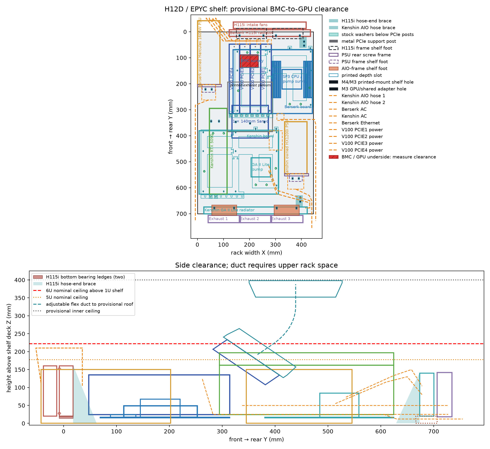
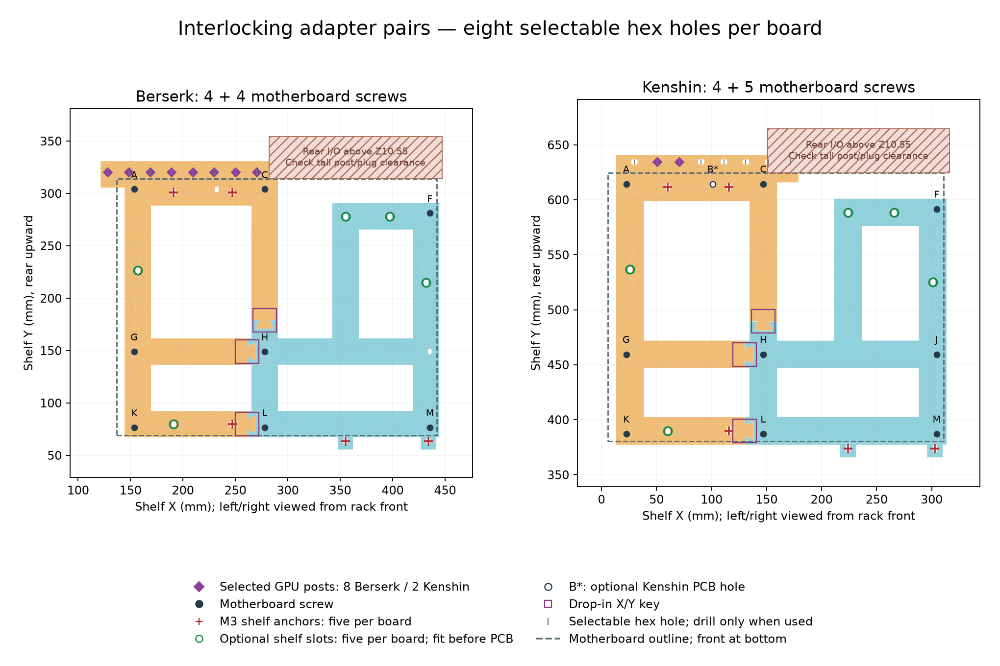
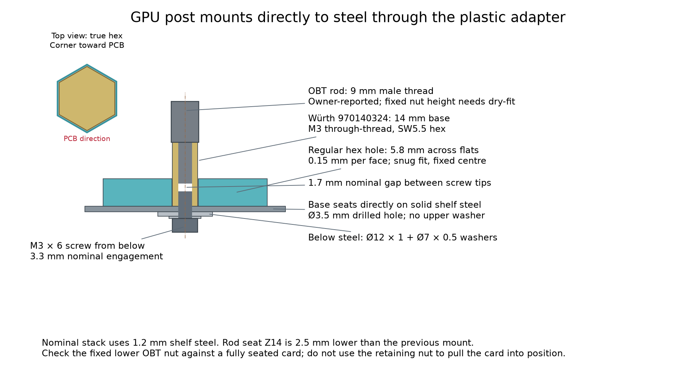
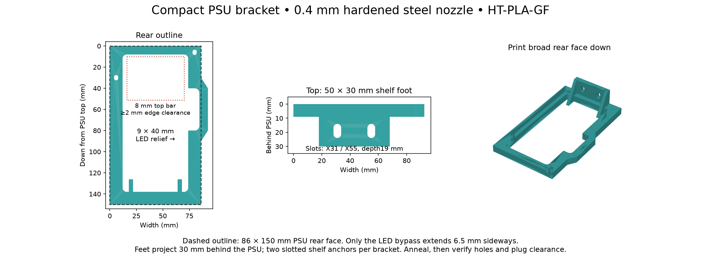
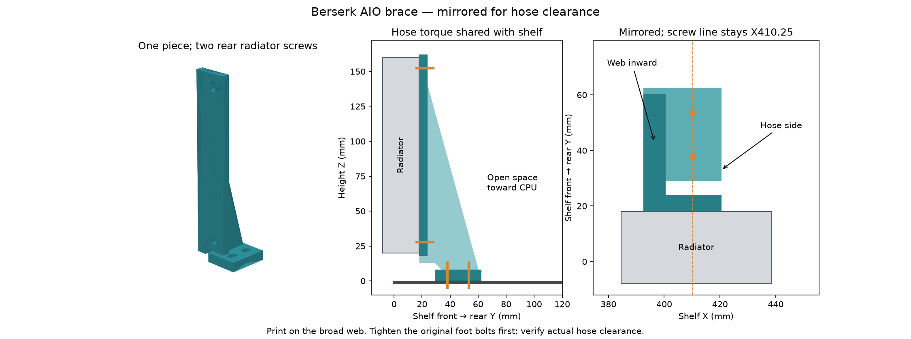
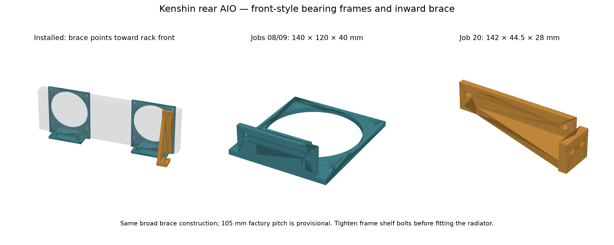
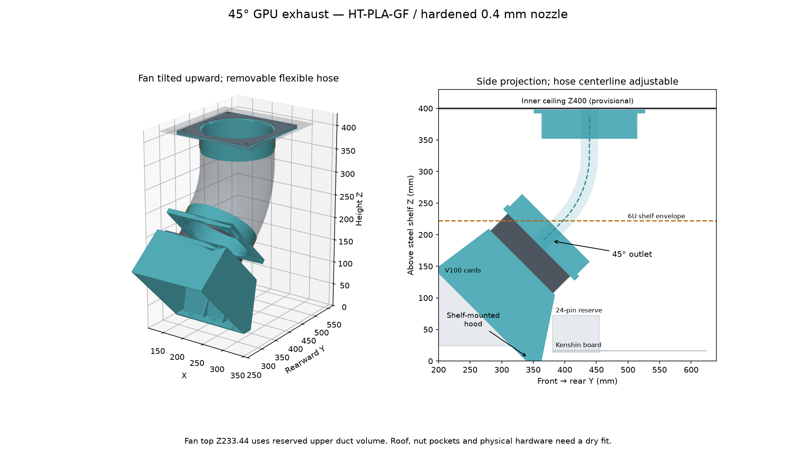
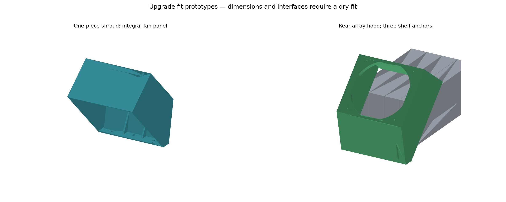

# Design: two PCs on one open shelf

This repository describes two PCs, **Berserk** and **Kenshin**, built on a single StarTech ADJSHELFHDV four-post shelf with 3D-printed mounts instead of cases. The layout fits a nominal 6U component envelope; the Berserk GPU exhaust duct rises above it to a ceiling chamber.

| System | Components |
| --- | --- |
| Berserk | HUANANZHI H12D-8D + BMC, AMD EPYC 7702P (64 cores / 128 threads, 200 W), 8 × 16 GB DDR4-3200 ECC RDIMM, four NVIDIA V100 PCIe 16 GB, 3 × 2 TB SK hynix PC801 NVMe (planned RAID 0), Corsair H115i (front, 140 mm fans), Rosewill Hercules 1600 W PSU |
| Kenshin | Gigabyte X870E AORUS PRO, AMD Ryzen 9 9950X3D, Zotac RTX 5090, Lian Li GA II LITE Performance 360 (rear, 120 mm fans), Corsair HX1200i |

Networking uses each board's onboard Ethernet (Berserk: dual 2.5GbE plus the dedicated BMC port). The full parts list is in [parts.xlsx](../parts.xlsx); assembly steps are in [assembly.md](assembly.md); print settings and materials are in [printing.md](printing.md).

**Berserk storage.** Selected on 2026-10-22: three used SK hynix PC801 2 TB M.2 2280 NVMe SSDs (HFS002TEJ9X101NFC), from [upwardassets' eBay listing](https://www.ebay.com/itm/880031659135). These replace the two reused Samsung 960 PRO 1 TB drives in the build's parts list. Plan a software RAID 0 array for downloadable model weights, with 6 TB nominal capacity and no redundancy. The [manufacturer specifies three PCIe 4.0 ×4 M.2 slots](https://www.huananzhi.com/en/list_6/177.html); populating all three leaves the boot layout to be decided. Aggregate bandwidth has not been measured. SSD cooling and clearance beneath the V100s remain provisional and require a physical check; they are not validated by the current CAD envelopes. The listing's 100% health is a seller claim; verify the delivered drives' SMART reports.

**Status.** This is a CAD fit study and prototype. Most interface positions come from manufacturer drawings, photographs and the owner's fit measurements, not from manufacturer CAD or a fully measured build. Every coordinate marked provisional below must be checked on real hardware before drilling. No printed part has a measured load or thermal-creep rating; a valid solid and a clean slice do not establish one.

## Generated files

All CAD is generated by `cad/shelf_layout.py` and the helpers in `cad/`. Run `make cad` to regenerate everything in `models/`, `make plates` to pack the print plates in `print/`, and `make gcode` to slice them into `print/gcode/` (not committed).

| File | Contents |
| --- | --- |
| [kenshin-berserk-6u-shelf-envelope.step](../models/kenshin-berserk-6u-shelf-envelope.step) | Full assembly envelope |
| [adjshelfhdv-drill-plan-deck.step](../models/adjshelfhdv-drill-plan-deck.step) | Shelf deck with the 39 selected holes |
| [adjshelfhdv-approx-vented-deck.step](../models/adjshelfhdv-approx-vented-deck.step) | Approximate vented deck (reference only) |
| [v100-tilted-exhaust.step](../models/v100-tilted-exhaust.step) | V100 hood, fan, flanges and duct route |
| [pcie-post-backing-washer-reference.step](../models/pcie-post-backing-washer-reference.step) | GPU post / adapter clamp stack |
| [fit-report.json](../models/fit-report.json) | Component envelopes, clearances, assumptions |
| [mount-hole-manifest.json](../models/mount-hole-manifest.json) | Every shelf hole, component hole and fastener |
| [assembly-access-audit.json](../models/assembly-access-audit.json) | Washer, head and driver-path checks |
| [gpu-exhaust-report.json](../models/gpu-exhaust-report.json) | Exhaust dimensions and assumptions |
| [shelf-vent-estimate.json](../models/shelf-vent-estimate.json) | Estimated vent pattern |

Each printed part also has its own STEP and STL in `models/`. The 14 print plates hold 18 printed parts: 17 installed parts and one fit coupon (see [print/README.md](../print/README.md)).

## Layout and coordinates

Coordinates are millimetres. **X** runs left to right viewed from the rack front, **Y** runs front to rear, and **Z** is height above the steel deck. The shelf body is 700 × 446 mm.

- **Berserk** occupies the front half. Its rear I/O faces the rack rear. The PSU sits at low X (X0–86), the H115i at the front edge. The H12D board spans X137–442, Y69.2–314.2.
- **Kenshin** occupies the rear half. Its board spans Y380.5–624.5, its PSU X335–421, Y345.5–545.5. Its AIO hangs off the rear edge.
- The V100 hood and fan sit between the two boards, Y333–363 at the base.

| Clearance or envelope | Value |
| --- | --- |
| Berserk board side margin to shelf edge | 4.0 mm nominal |
| Kenshin board side margin | 6 mm |
| V100 hood to RTX 5090 | 2.08 mm nominal |
| Hercules PSU front overhang | 42.5 mm (202.5 mm of 245 mm on steel) |
| H115i fan front | Y−38 |
| Front power-route envelope | reaches Y−57.5; allow at least 60 mm front space |
| Kenshin rear fans / screw heads | Y734.5 / Y738.5 (38.5 mm past the shelf) |
| V100 fan top | Z233.44, 11.19 mm above nominal 6U |
| Provisional inner ceiling for the duct | Z400 |

The layout does not fit in 5U. Shelf lips, slides, rails and fascia are not modeled; measure the real flat support width, cabinet liners and door clearances.

## Motherboard adapters

Each board sits on a pair of flat 6 mm printed sections with 25 mm rails:

| Plate | Model | Use |
| --- | --- | --- |
| `01_atx_mobo_adapter_front` | `atx_mobo_adapter_front` | Front section, one per board (print 2). Two M3 front ears. |
| `02_atx_mobo_adapter_rail` | `atx_mobo_adapter_rail` | Kenshin rear rail, eight post slots at the standard ATX positions. |
| `03_h12d_mobo_adapter_rail` | `h12d_mobo_adapter_rail` | Berserk rear rail, slots shifted 32.3 mm toward low X for the four V100s. |

Three broad drop-in dovetail keys locate each pair in X/Y. They do not retain Z: brass standoffs and shelf fasteners do. Each section carries at least four non-collinear board screws.

**Standoffs.** Keystone 1451B #6-32 brass standoffs (9.525 mm) put the PCB underside at Z15.525. The H12D uses eight populated holes, A/C/F/G/H/K/L/M; **do not fit standoffs at B or J**. Kenshin uses nine, with B optional only if the delivered PCB has that hole. That is 17 required standoffs. The adapters keep the unused B/J slots. Low-head #6-32 screws sit in 10.8 × 8.5 mm elongated, 3 mm deep underside recesses behind 6 × 3.7 mm through-slots, giving ±1.15 mm depth travel. Check a real screw head before printing.

The ATX pattern uses 72.39 mm between the middle and far mounting rows. This value was confirmed by the owner's fit measurement.

**Rear rail.** A continuous 25 mm deep rear rail gives eight selectable GPU-post slots per board, each 10 × 5.5 mm, centred 7.5 mm behind the PCB rear edge. Board-local slot centres:

- H12D: X−8.42 / 11.58 / 32.22 / 52.22 / 72.86 / 92.86 / 113.50 / 133.50 (the low-X end extends past the PCB to support the lowest card).
- Kenshin: X23.88 / 44.44 / 64.76 / 84.52 / 105.16 / 125.16 / 145.80 / 165.80.

Slots allow ±0.6 mm X and ±2.5 mm Y travel. Only selected slots need hardware.

**Front ears.** 14 mm wide with 8 × 4 mm slots (±2 mm depth travel), M3 × 16 bolts and Ø7 × 0.5 mm top and back washers on sound steel. Common ears at local X218/297 clear Berserk's AIO brace.

**Optional inner anchors.** Six more 8 × 4 mm slots per board can take M3 × 16 bolts, Ø7 × 0.5 washers and nuts. Their heads top at Z9.5, below the PCB at Z15.525. They must go in before the PCB covers them. These twelve sites are excluded from the default drill plan.

**I/O shield.** The ATX datum puts the conservative lower shield edge at Z10.5466, which leaves 4.5466 mm above the 6 mm rail. That is a rail allowance only. Some Kenshin high-X post positions fall inside the shield projection, and plugged-in cables are not checked. Dry-fit the seated cards, ports and plugs before choosing post holes.

## GPU posts and rests

Each GPU bracket is held by two Open Benchtable PCI-E support rods. Each rod stands on a Würth 970100354 M3 10 mm female/female brass base that also clamps the motherboard adapter rail to the shelf. Berserk uses eight posts and Kenshin two:

| Board | Selected post centres |
| --- | --- |
| Berserk | X128.58 / 148.58 / 169.22 / 189.22 / 209.86 / 229.86 / 250.50 / 270.50, Y320.20 |
| Kenshin | X51 / 71, Y634.50 |

**Clamp stack, bottom to top:** M3 × 12 screw → Ø7 × 0.5 washer → Ø12 × 1 backing washer (M4 DIN 9021, OD12/ID4.4) → 1.2 mm nominal steel shelf → 6 mm adapter → Ø9 × 0.5 top washer → 10 mm female/female base → OBT rod.

The lower screw has 2.8 mm nominal thread engagement. Hold the base's SW5 flats and tighten from below. The base raises the rod by 6.5 mm. The CAD does not specify cutting the rod. Check the real shelf and washer thicknesses, the thread depth and the OBT stud length: the two screw ends must not meet. Rod length, top-nut travel and GPU flange centres are not measured.

**V100 slots.** The four cards sit in PCIE1–4 at slot planes X279.50 / 238.86 / 198.22 / 157.58, each at PCIe 3.0 x16 (the card's limit). The provisional 40 mm card bodies extend 36 mm toward low X and 4 mm toward high X, leaving only 0.64 mm between cards. Remove the OEM extenders. NVIDIA's [V100 brief](https://www.nvidia.com/content/dam/en-zz/Solutions/Data-Center/tesla-product-literature/Tesla-V100-PCIe-Product-Brief.pdf) gives a 266.7 × 111.15 mm body. Card bodies run Y47.5–314.2.

**V100 tail spacers.** Each V100 tail rests on an M4 female/female 20 mm metal spacer with a 4 mm silicone pad, fastened from below with a steel washer at Y57.5 (X263.5 / 222.86 / 182.22 / 141.58). [RS PRO 222-496](https://docs.rs-online.com/cfbb/A700000007999949.pdf) is an example. The pad must touch a rigid frame surface, clear of PCB components and heatsink airflow. No printed plastic carries the hot V100 tails.

**RTX 5090 rest** (`04_gpu_rest`). A 24 mm wide printed block at X43–93 supports the front end of the 5090. It has two M4 shelf anchors at X53 / 83, Y344.25, in 17 × 12 mm, 6 mm deep recesses. Use 9 mm OD washers, and keep washer plus head no more than 5 mm tall, which leaves 1 mm nominal clearance under the card. Adjust the rest so it touches a rigid shroud or frame surface without lifting the card out of its slot.

**BMC clearance (unresolved).** The H12D BMC is modeled as a provisional 7 mm tall envelope. It overlaps the simplified solid GPU bodies by 0.125 mm. This is an open check, not a confirmed collision or a confirmed fit. Measure the BMC components, headers and real card undersides before assembly.

## PSU bracket

Both PSUs use the same printed bracket, `psu_bracket`, two copies on plate `05_psu_brackets`. The steel shelf carries the PSU weight. The bracket restrains the PSU sideways and against tipping. It is not a lifting handle.

- Fits the 86 × 150 mm ATX PSU rear face, with uniform 9 mm thick rear faces and a continuous lower rail.
- **8 mm top bar.** The owner measured the power connector more than 10 mm below the PSU top, which leaves at least 2 mm nominal clearance. Confirm the molded plug seats fully.
- **9 × 40 mm LED relief** for the Hercules side LED (centre about 80 mm across and 60 mm down from the PSU top, estimated from photographs). An 8 mm bypass web extends 6.5 mm past the 86 mm PSU face, so the maximum width is 92.5 mm. It does no harm on a PSU without a side LED.
- The two upper factory screws pass through 5 × 4 mm vertical slots with at least 4 mm side and 3.5 mm top material. Use washers and verify safe factory thread engagement.
- **Feet:** 50 × 30 × 6 mm with two tapered side gussets. There are two 10 × 5.5 mm shelf slots side by side, 19 mm behind the rear face, with 6 mm of plastic beyond each slot end.

| PSU | Body | Shelf anchors |
| --- | --- | --- |
| Berserk (Hercules) | X0–86 | X31 / 55, Y221.5 |
| Kenshin (HX1200i) | X335–421 | X366 / 390, Y564.5 |

Use M4 through-bolts, OD12 washers and nuts. The brackets are printed in HT-PLA-GF and annealed (see [printing.md](printing.md)). Check AC plug insertion, LED clearance and cord routing during the dry fit.

## 140 mm AIO frames and hose brace (Berserk H115i)

The H115i mounts at the front edge as a sandwich: **front fans → printed frames → radiator**. Its fans pull air rearward through the radiator. The frame faces sit about 13 mm ahead of the shelf edge, from the owner's fit measurement.

| Element | Y range |
| --- | --- |
| Fans | Y−38 to −13 |
| Frame faces | Y−13 to −8 |
| Radiator | Y−8 to 18 |
| Frame feet | to Y27, anchors at Y15 |

**Frames** (`06_fan140_aio_frame`, print 2). Each is 140 mm wide × 160 mm tall, flush with the fan top and sides above a 20 mm lower support. Holes are on the 124.5 × 124.5 mm 140 mm fan pattern (see [Noctua's 140 mm drawing](https://cdn.noctua.at/media/noctua_nf_a14_pwm_infosheet_en_web-1.pdf)) as 7 × 4.5 mm vertical slots, with 4.25 mm top and 5.5 mm side ligaments. Two broad 6 mm ledges carry the radiator at Z20 with paired continuous 4 mm side webs. Each 40 mm foot projects 13 mm ahead of the shelf and keeps 27 mm of steel bearing. Shelf anchors are at X162 / 254 / 302 / 394, Y15. At full ±2.5 mm slot travel, OD12 washers keep 6.5 mm from the front edge. Eight shared screws pass through fan and frame into the radiator's factory threads. The thread and safe engagement depth are not measured.

**Hose brace** (`07_fan140_aio_hose_brace`). A triangular brace on the hose end takes fore/aft hose torque, independent of the CPU and motherboard. The frames still carry the radiator's weight.

- Bounds X392.5–420.5, Y18–62.5, Z0–162. The 8 mm web lies inward at X392.5–400.5, away from the hoses.
- A 6 mm radiator flange attaches to the two unused rear factory holes at X410.25, Z27.75 / 152.25, with matching screws and OD10 washers.
- The 8 mm shelf foot runs Y29–62.5 and stops 6.70 mm ahead of the board. Shelf anchors are at X410.25, Y38 / 53.5 with ±1.5 mm slots, two M4 bolts, two nuts and four OD12 washers.
- The front web is raised to Z13 to clear the frame foot and its bolt head (2 mm above the 11 mm head envelope).
- The brace stops 13.5 mm short of the radiator end. That does not prove hose clearance.

**SP3 fit.** Reusing the H115i depends on its exact revision, a correct SP3 bracket and mounting pressure, cold-plate coverage of the EPYC, and relaxed hose reach.

## 120 mm AIO frames, hose brace and spacer (Kenshin Lian Li 360)

Kenshin's [Lian Li GA II LITE Performance 360](https://lian-li.com/product/ga-ii-lite/) (397 × 120 × 27 mm radiator, 400 mm hoses, three 124 × 120 × 28 mm fans) mounts at the rear edge: **radiator inward → frames and spacer → fans outward**. All three fans pull air toward the rack rear. The radiator sees air already warmed by the components, so qualify CPU and GPU temperatures together.

| Element | Y range |
| --- | --- |
| Radiator | Y673.5–700.5 (49 mm behind the board and GPU) |
| Frames and spacer | Y700.5–706.5 |
| Fans | Y706.5–734.5 |
| Screw heads | to Y738.5 |

**Frames** (`08_fan120_aio_frame`, print 2). Each is 120 mm wide × 140 mm tall, flush with the nominal fan above a 20 mm lower support, at X43–163 and X283–403. Holes are on the 105 × 105 mm 120 mm fan pattern ([Noctua spec](https://noctua.at/en/products/fan/nf-a12x25-pwm/service)) as 7 × 4.5 mm slots, with 4 mm top and 5.25 mm side ligaments. Each frame has a 96 mm wide foot with 40 mm reach, a 64 × 27.5 × 6 mm bearing ledge at Z20 and paired 4 mm tapered webs. Shelf anchors are at X65 / 141 / 305 / 381, Y678.5. The 10 × 5.5 mm slots allow ±2.5 mm, and OD12 backing keeps 13 mm rear margin.

**Center spacer** (`10_fan120_aio_center_spacer`). A plain 119 × 119 × 6 mm plate that keeps the middle fan coplanar. Don't recess it: the fans use side bridge connectors.

**Hose brace** (`09_fan120_aio_hose_brace`). This brace uses the same 8 mm web, 6 mm radiator face and 8 mm foot as the 140 mm brace, on the 105 mm pitch. It occupies X377.75–405.75, Y629–673.5, Z0–142. The web points toward low X, away from the right hose end. Two inward factory radiator screws at X395.5, Z27.5 / 132.5 (±2 mm vertical slots) share the hose load with two M4 shelf anchors at X395.5, Y638 / 653.5 (±1.5 mm slots).

**Clearances.** Radiator Z20–140. Frames top at Z140, which leaves 82.25 mm to nominal 6U. The brace tops at Z142 (80.25 mm). Nominal brace gaps are 2.75 mm to the right frame, 8.35 mm to the AC route and 9.25 mm to the modeled hoses. Allow 35 mm of straight driver access behind the rear screw heads, and check the cabinet door and rails.

Radiator hole pitch, thread, safe engagement, fitting positions and hose path are not measured. Never drill the radiator.

## V100 hood, fan and exhaust duct

The four passive V100s are cooled by one **Sanyo Denki 9GV1412P1S001** (140 × 140 × 38 mm, 12 V, 3.1 A / 37.2 W, 272 CFM free air, 480 Pa shutoff, 67 dBA) that pulls air through all four heatsinks. Free-air flow and shutoff pressure are separate operating points, and the flow delivered through the heatsinks has not been measured. Dimensions and wiring come from the [Sanyo Denki catalog](https://publish.sanyodenki.com/San_Ace_E/book/data/San_Ace_E.pdf); the CAD fan is a simplified model.

**Hood** (`12_v100_gpu_shroud`). One 3.2 mm hood with an integral 10 mm fan panel covers the rear portion of all four cards.

- Its straight inlet edge runs from Y194 / Z145 down to the shelf at Y339, with a continuous 45° bevel into the base. Broad sidewalls clear the post rods without cutouts.
- The base measures 173.32 × 30 × 6 mm, with 24 mm of ground contact after the front bevel. It occupies Y333–363, starts 2.3 mm behind the adapter rail and ends 17.5 mm ahead of Kenshin's PCB (about 1.7 mm to its adapter ears).
- Three internal 8 × 5.5 mm slots (±1.25 mm travel) anchor it at X147.54 / 257.54, Y347 and X202.54, Y352.5 with M4 × 16 bolts, nuts and OD12 washers.
- Four permanent 4 mm triangular ribs stiffen the chamber. The part prints without removable supports.
- The fan panel faces **45° upward and rearward**, centred at X202.54 / Y325 / Z150.
- Seal the common lower opening and inlet perimeter with secured, nonconductive flexible foam so air passes through the heatsinks.
- Check the high-X sidewall against Berserk's actual rear ports and I/O shield. These shapes are not measured.

**Fan fastening.** Each fan face uses four M4 2020 hammer T-nuts in open 12.2 × 6.4 × 4.8 mm pockets, sized from a [comparable manufacturer drawing](https://www.motedis.com/shop/products_files/Motedis_S6BHASNM4-Drawing.pdf). The selected [T-nut kit](https://www.amazon.ae/Sutemribor-Hammer-Fastener-Aluminum-Profile/dp/B07FPLZXTF) is not measured, so print `11_tnut_fit_coupon` first. The inlet uses four M4 × 14 socket caps and the outlet four M4 × 16, each with OD9 × 1 washers. Each face clamps only the 4 mm fan flange to a 10 mm printed panel.

**Exhaust duct.**

- `13_gpu_exhaust_fan_flange`: 10 mm face and 28 mm neck. Its opening is the intersection of a 138 mm square and a 145.5 mm circle, inside the 140 mm fan face.
- `14_gpu_exhaust_roof_flange`: 40 mm neck, 8 × 5.5 mm adjustment slots, 2 mm silicone gasket, four M4 × 20 bolts, nuts and eight OD12 × 1 washers. It mounts on a candidate 154 mm opening in the inner ceiling. Do not cut the outer lid.
- A 6-inch (152.4 mm ID) wire-supported flexible duct connects the 151.5 mm necks. Its planning route ends near X203 / Y449 / Z400, with about 220 mm of modeled centreline. Buy about 1 m and trim it after a service test.
- Use two [McMaster 53185K52](https://www.mcmaster.com/53185K52/) lever clamps (152–159 mm range), one per end. Centre the 22.225 mm band on the 28 mm fan neck without crushing its 3 mm wall.
- Support the duct's weight from rack structure with a strap, not from the hood.

The rigid fan and flange clear the modeled Kenshin 24-pin cable reserve. Verify the real cable. The roof opening, gasket and route are provisional. Survey the ceiling's factory fans, wires, ribs and baffles before cutting. The pressure fan and the roof fans do not have additive CFM ratings.

**Fan power and control.** Feed the fan 12 V from the PSU through a controller rated for 3.1 A plus verified startup current, never from a motherboard header. Leads: red +12 V, black ground, yellow tach, brown 25 kHz PWM. An open PWM line runs the fan at full speed, and 0% duty stops it. Configure full speed at startup and on faults, control speed from the hottest GPU, and stop GPU load if tach is lost. A single fan failure removes cooling from all four GPUs.

## Power and thermal guidance

- **V100 power.** The V100 power socket uses **CPU/EPS 8-pin wiring**. Use a dual-PCIe-8-pin-to-EPS adapter (030-0571-000 compatible), checked against NVIDIA's pinout. Never plug a PCIe 8-pin directly into the card. Four adapters need eight properly rated PCIe feeds from the Hercules's own modular cables, plus the 24-pin and two EPS 8-pin for the board.
- **Low-profile EPS extension.** The CAD reserves 18 mm for a 90° CPU/EPS extension at Y29.5–47.5, 11.5 mm behind the radiator, with the cable rising at Y35.5 to Z215 (7.25 mm below the 6U ceiling). The 18 mm is a design target, not a measured product dimension. Verify pinout, current rating, seated projection and bend.
- **Power cap.** Four V100s draw up to 1,000 W at default limits. Start around **180 W per card**, measure temperatures and performance, and raise the limit only after a stable sustained test. Check Berserk's total load against the 1600 W PSU's output and cable allocation, and against any UPS.
- **Printed-part temperatures.** Treat 50 °C on a loaded printed surface as an inspection trigger, not a material rating. Stop immediately for softening, creep, looseness or fan failure. The PSU brackets and GPU cooling and duct parts are HT-PLA-GF. The other mounts are PETG.
- Kenshin's AC cord exits around the right side of its radiator. Check fan arrows and PSU exhaust directions on both machines.

## Cable routes

The plan models AC cords, Berserk's onboard RJ45 and the four V100 power leads. Use low-profile or down-exit C13 cords on the Corsair PSU and a cord matching the Hercules inlet. Keep each PSU's modular cables with that PSU. The 24 + 8 + 8 board power bundles, BMC and RJ45 plugs, EPS extensions and AIO hoses all need a dry fit. These routes do not establish a 5U fit.

## Shelf drill plan

The [StarTech drawing](https://sgcdn.startech.com/005329/media/sets/ADJSHELFHDV_Diagram/ADJSHELFHDV_Diagram.PDF) gives a 700 × 446 mm body with 40 × 6.5 mm vents, but no vent centres. The vented deck model and vent estimate are approximations.

The [drill-plan deck](../models/adjshelfhdv-drill-plan-deck.step) has **39 holes: 25 M4 and 14 M3**.

| Group | Count | Size | Hardware |
| --- | ---: | --- | --- |
| Printed-part anchors (frames, braces, PSU brackets, 5090 rest, hood) | 21 | M4, Ø5 mm hole | M4 bolt, OD12 washers, nut |
| V100 tail spacers | 4 | M4, Ø5 mm | M4 from below into 20 mm spacer |
| Front motherboard anchors | 4 | M3, Ø3.5 mm | M3 × 16, Ø7 × 0.5 washers, nut |
| Shared GPU post / adapter joints | 10 | M3, Ø3.5 mm | Clamp stack above |

Slot travel checked in CAD: printed foot slots 10 × 5.5 mm ±2.5 mm; motherboard front and optional M3 slots 8 × 4 mm ±2 mm; hood 8 × 5.5 mm ±1.25 mm; brace shelf slots 8 × 5.5 mm ±1.5 mm. Exact centres are in [mount-hole-manifest.json](../models/mount-hole-manifest.json). The [access audit](../models/assembly-access-audit.json) checks washer, head and straight-driver envelopes across slot travel. It does not account for hands or tool handles.

Rules for drilling:

- Survey real vents, lips and sound steel first. Use a real vent where it fits.
- Drill through the slots of a positioned, clamped bare part. The slots give access and adjustment, not a precise drill guide.
- Remove all electronics before drilling, then deburr.
- Back every joint with a steel washer. The shelf's distributed-load rating does not rate an individual hole.
- Ground one motherboard standoff to the shelf.

## Physical release checks

1. Fit the empty shelf in the rack. Survey usable width, vents, lips, rails, underside access, the side cable lane and the rear door.
2. Dry-place both boards, all five GPUs, both PSUs, both radiators, the posts and the cooling module. Record real slot and flange coordinates, GPU thickness, factory holes, power leads, pump hoses and fan arrows. Update the CAD before drilling or printing final parts.
3. Fit-test the motherboard adapter pairs, the T-nut coupon, the hood with its inlet seal, and one of each bracket. Check screw-head and washer envelopes and safe thread engagement.
4. Verify the GPU power adapter pinout and PSU feeds, GPU enumeration and ECC health, BMC access, onboard Ethernet and sustained GPU operation.
5. With the cabinet closed, run a staged concurrent load. Record wall power, GPU / HBM / CPU / PSU temperatures, airflow, noise and loaded printed-part temperatures. Test fan and controller failure behaviour. Reinspect for creep, rocking and loose fasteners.

The design stays a prototype until these measured mechanical, thermal, electrical and software checks pass.
