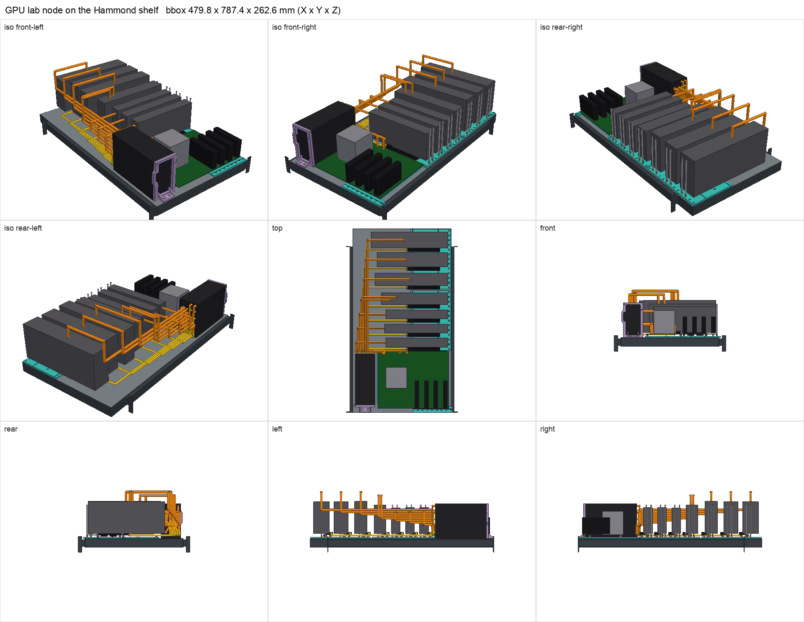

# GPU lab: seven test GPUs on one Hammond shelf

A test node for mixed GPUs. One HUANANZHI H12D-8D feeds seven cards over MCIO cables: each x16 slot is split x8x8 and drives two cabled riser boards. The cards stand upright on two printed 13-position baseboards that run along the shelf depth, with their brackets on metal posts. Each GPU is meant to be passed through to its own VM with CloudRift, so every card can run its own driver.

**Status: design.** Nothing is bought, printed or fitted. The CAD and checks pass on the numbers given, but the riser board outline, the host adapter envelope, the bracket post offsets and the PSU depth are not measured. The power budget passes only with the GPU power caps below.



## Layout

| Item | Where |
| --- | --- |
| [Hammond RSUS1931BK1](parts/hammond-rsus1931bk1.md) | 422.7 × 787.4 mm sliding shelf, 39 kg rating |
| [Super Flower Leadex 2800W](parts/super-flower-leadex-2800w.md) | Front left, on its side, modular face toward the rear so the leads run straight back past the card tails. Held at its AC face by AIPC's [PSU bracket](parts/psu_bracket.md), turned 180 degrees, with two M4 bolts through the deck |
| [H12D-8D](parts/huananzhi-h12d-8d.md) | Front right, I/O edge facing the rack front, on the same printed mount as AIPC's Berserk: the [rail section](parts/h12d_mobo_adapter_rail.md) and the [far section](parts/atx_mobo_adapter_front.md), turned 180 degrees, with 3/8 in standoffs on top and five M3 bolts through the deck. The rail is flush with the deck front |
| [C-Payne CP-0120](parts/cpayne-cp0120-mcio-host-adapter.md) × 4 | In the four x16 slots, two MCIO 8i ports each (x8x8) |
| [Baseboards](parts/gpulab_baseboard.md) × 2 | 172.8 × 257.8 × 6 mm PETG, end to end along the deck from Y 264.9 to 786.9 mm: 26 positions on one 20.32 mm pitch |
| [C-Payne CP-0231](parts/cpayne-cp0231-mcio-device-adapter.md) × 7 | Riser boards on M3 standoffs; M3 nuts slide in two channels under each baseboard, so a riser fits under any position |
| [Power leads](parts/psu-modular-cables.md) | Back along the left edge of the deck past the card tails; GPU leads to each card's tail end or over its top edge, riser leads low through the gap in front of each card, board leads across to the 24-pin and EPS |
| Posts × 14 | Wurth 970140324 hex bases through the baseboard onto the steel, Open Benchtable rods on top: two per card under the bracket tabs, as in AIPC |

Cards stand across the shelf width with the bracket on the right and the tail to the left, cooler side toward the rear. Each card takes enough positions for its thickness plus an air gap (18 mm for open-air and flow-through coolers, 3 mm for blowers). The rearmost card's fans face the open rack space past the deck end.

| Positions | Card | Cooler | Air gap |
| --- | --- | --- | --- |
| 1–3 | [AMD Radeon AI PRO R9700](parts/amd-radeon-ai-pro-r9700.md) | blower | 21.0 mm |
| 4–6 | [ASRock Arc Pro B60 Creator](parts/asrock-arc-pro-b60-creator.md) | blower | 22.0 mm |
| 7–9 | [Intel Arc Pro B70](parts/intel-arc-pro-b70.md) | blower | 22.0 mm |
| 10–13 | [AMD RX 7900 XTX](parts/amd-rx-7900-xtx-reference.md) | open-air | 29.8 mm |
| 14–17 | [RTX 3090 FE](parts/nvidia-rtx-3090-fe.md) | flow-through | 27.3 mm |
| 18–21 | [RTX 4090 FE](parts/nvidia-rtx-4090-fe.md) | flow-through | 20.3 mm |
| 22–25 | [Zotac RTX 5090 Solid](parts/zotac-rtx-5090-solid.md) | open-air | 13.5 mm to the deck end |

Position 0 stays empty: a riser there would reach over the board's far edge.

The reused AIPC mount is what makes the depth tight. Its rail runs 16.5 mm in front of the I/O edge (it keeps Berserk's eight V100 post holes, unused here), and the board sits 6 mm higher than on bare standoffs, level with the riser boards. With the rail flush at the deck front and baseboard B 0.5 mm from the deck rear, riser 1 clears the board's far edge by 1.7 mm and the mount clears baseboard A by 1.4 mm. The layout generator asserts on collisions, air gaps, riser screws landing in the baseboard slots, cards staying on the deck, and MCIO cable reach. All seven routes fit a 0.75 m cable; the 5090's is tightest, with 64 mm spare. The three blower cards would also fit 0.45 m cables. The cards top out at 160 mm above the deck, and the leads over the top-edge connectors at 205 mm. The parts with a known mass put 18.7 kg on the shelf (the R9700's mass is unknown). Coordinates, routes and the deck drill plan are in [models/gpulab-fit-report.json](models/gpulab-fit-report.json).

### Power leads

The leads are modeled approximately: round bundles (8–15 mm) on orthogonal routes, with 40 mm of straight lead above each top-edge connector before the bend. They are checked against every rigid part but not against each other. Where each card's power connector sits (tail end or a distance along the top edge) and where the board's 24-pin and EPS sit are allowances from product photos and ATX convention, recorded in the library specs (`part.toml`).

| Lead | Modeled route | Buy at least (+10%) |
| --- | ---: | ---: |
| R9700 12V-2x6 | 264 mm | 290 mm |
| B60 8-pin | 316 mm | 348 mm |
| B70 8-pin | 376 mm | 414 mm |
| 7900 XTX 8-pin × 2 | 568 mm | 625 mm |
| 3090 FE 12V-2x6 | 701 mm | 771 mm |
| 4090 FE 12V-2x6 | 760 mm | 836 mm |
| 5090 12V-2x6 | 829 mm | 912 mm |
| Riser 6-pin leads 1–7 | 322–736 mm | 354–810 mm |
| Board 24-pin / EPS × 2 | 176 / 325–337 mm | 194 / 358–371 mm |

The PSU's stock lead lengths are not published. The rear GPUs and risers likely need longer leads or extensions; measure the stock set against this table.

## Power

The seven cards draw 2,460 W at stock limits; with the CPU, board and risers (295 W) the node would need about 2,755 W DC. The repo's rule loads a PSU to 80% at most, 2,240 W for the 2800 W unit, so every card runs with a power cap, set at boot. With the caps the node needs 2,205 W (79% of the PSU rating). The caps are recorded as `load_limited` in each card's `parts/<id>.toml`, so `make check` reports the budget as provisional.

| Card | Stock | Cap | Set with |
| --- | ---: | ---: | --- |
| RTX 5090 Solid | 575 W | 400 W | `nvidia-smi -i <gpu> -pl 400` |
| RTX 4090 FE | 450 W | 320 W | `nvidia-smi -i <gpu> -pl 320` |
| RTX 3090 FE | 350 W | 250 W | `nvidia-smi -i <gpu> -pl 250` |
| RX 7900 XTX | 355 W | 320 W | `rocm-smi -d <gpu> --setpoweroverdrive 320` |
| Radeon AI PRO R9700 | 300 W | 270 W | `rocm-smi -d <gpu> --setpoweroverdrive 270` |
| Arc Pro B70 | 230 W | 190 W | `xpu-smi config -d <gpu> --powerlimit 190` |
| Arc Pro B60 Creator | 200 W | 160 W | `xpu-smi config -d <gpu> --powerlimit 160` |

Total: 1,910 W for the cards. Notes:

- Benchmarks run at these caps, not at stock power. To test one card at stock, lower the others so the total stays under 1,945 W.
- The minimum cap each driver accepts is not checked. AMD often allows only about 10% below stock, which is why the AMD caps are the mildest. Read the limit back after setting it (`nvidia-smi -q -d POWER`, `rocm-smi --showmaxpower`, `xpu-smi stats`). If a driver refuses a cap, lower another card's.
- Set the caps in each VM or on the host before any load, and again after every reboot or driver reload. A card at stock power can overload the PSU.

The 2800 W PSU accepts 200–240 V only and draws about 3 kW from the wall at full load, so the node needs a 240 V circuit (20 A or more).

The PSU's six 6+2 leads are not enough for three GPUs' 8-pin inputs plus seven riser boards; five [8-pin splitters](parts/pcie-8pin-splitter.md) feed the risers in pairs (75 W each). Never put a splitter on a GPU's own connector.

## Open questions

The full list is in [docs/system-check.md](docs/system-check.md). The ones that block buying:

1. **x8x8 bifurcation on the H12D-8D** is not in the manual. Check AMD CBS → NBIO in the BIOS (Berserk runs the same board).
2. **Riser board geometry.** C-Payne publishes a 3D model but no drawing: the outline, hole positions and slot position are scaled from a photo. Take them from the model or a measured board before printing.
3. **CP-0120 per-port REFCLK/PERST**: ask C-Payne.
4. **Power caps** are enforced only by software (above). Also open: the **240 V circuit**, the **rack cabinet** and the **CPU cooler**, which is not chosen yet (100 mm envelope reserved).
5. **Bracket seating.** The riser PCB sits 0.475 mm higher than the H12D PCB the AIPC posts were surveyed for. Check that brackets seat on the posts with each card fully inserted.
6. **Lead lengths and connector positions**: measure the stock leads and each card's connector position (table above).
7. **Card support and airflow.** Cards hang from bracket and slot only, with no tail rest yet. There is no forced airflow; the open-air cards dump heat around themselves.
8. **Reused AIPC mounts.** The PSU bracket assumes the 2800 W unit's rear face carries the standard ATX screw holes and that it lies on the same side as AIPC's PSUs; check both. The tight depth above rests on the photo-estimated riser width and the listed 245 mm board depth: dry-fit the board on its mount with riser 1 in place before printing the baseboards.

## What's here

| Path | Contents |
| --- | --- |
| [parts/](parts/README.md) | One `<id>.toml` per part: a reference to its spec in the shared [library](../parts/README.md), with quantity, role, power caps and assembly mapping for this build; generated pages with the checks |
| [docs/system-check.md](docs/system-check.md) | Compatibility, assembly-coverage and evidence report (generated) |
| [models/](models) | Assembly STEP, fit report with the drill plan and cable routes, [assembly renders](models/renders/assembly.png) |
| [print/](print/README.md) | Baseboard plate, plates for the reused AIPC mount and PSU bracket, profiles and the manifest |
| [cad/](cad) | [layout.py](cad/layout.py) builds the assembly, the baseboard and the fit report; [print_jobs.py](cad/print_jobs.py) packs the plate |
| [build.toml](build.toml) | Build settings read by [hwkit](../hwkit) |

## Regenerating

From the repo root ([AGENTS.md](../AGENTS.md) has the setup):

```bash
make all BUILD=gpulab
```

```bash
make gcode BUILD=gpulab
```

`make all` ends with `make check`, which exits non-zero if any check FAILs.
