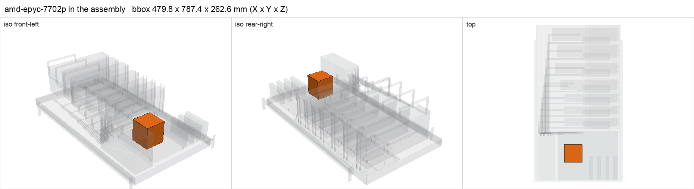

# AMD EPYC 7702P

<!-- Generated by make check from amd-epyc-7702p.toml and the library part.toml. Edit those, not this file. -->

Library spec: [parts/purchased/amd-epyc-7702p](../../parts/purchased/amd-epyc-7702p/README.md) (dimensions, interfaces, datasheets, model).

| | |
| --- | --- |
| Role | node CPU (same model as Berserk's) |
| Status | candidate |
| Quantity | 1 |
| Systems | node |

Any SP3 EPYC 7002/7003 works; the 7702P is assumed here because Berserk runs
one. The CPU cooler is not chosen: the layout reserves a 100 mm envelope above the board.

## Changes for this build

- requires `cooler-mount`: no field changes — cooler not chosen

## Assembly

- 1 instances in the assembly

## Compatibility checks

| Status | Rule | Interface | Detail |
| --- | --- | --- | --- |
| BLOCKED | presence | `cooler-mount` | nothing in systems ['node'] provides 'cooler-mount' |
| BLOCKED | budget | `shelf-load` | load 18.5 kg of 39.0 kg x derate 1.0 = 39.0 kg (47% of rating); unknown load for ['amd-radeon-ai-pro-r9700'] |
| provisional | budget | `dc-power` | load 2205.0 W of 2800.0 W x derate 0.8 = 2240.0 W (79% of rating); relies on configured limits of ['amd-radeon-ai-pro-r9700', 'amd-rx-7900-xtx-reference', 'asrock-arc-pro-b60-creator', 'intel-arc-pro-b70', 'nvidia-rtx-3090-fe', 'nvidia-rtx-4090-fe', 'zotac-rtx-5090-solid']; unlimited peak 2755.0 W |
| pass | value | `cpu-socket` | amd-epyc-7702p needs SP3; provided by huananzhi-h12d-8d |

