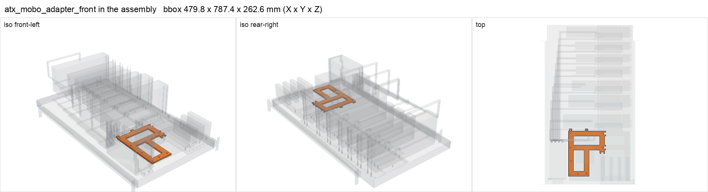

# atx_mobo_adapter_front

<!-- Generated by make check from atx_mobo_adapter_front.toml and the library part.toml. Edit those, not this file. -->

Library spec: [parts/printed/atx_mobo_adapter_front](../../parts/printed/atx_mobo_adapter_front/README.md) (dimensions, interfaces, datasheets, model).

| | |
| --- | --- |
| Role | H12D-8D mount section on the side away from the I/O, reused from AIPC |
| Status | design |
| Quantity | 1 |
| Systems | node |

## Assembly

- 1 instances in the assembly

## Compatibility checks

| Status | Rule | Interface | Detail |
| --- | --- | --- | --- |
| BLOCKED | budget | `shelf-load` | load 20.1 kg of 39.0 kg x derate 1.0 = 39.0 kg (52% of rating); unknown load for ['amd-radeon-ai-pro-r9700'] |
| provisional | value | `mobo-front-section` | huananzhi-h12d-8d needs ATX; provided by atx_mobo_adapter_front |
| provisional | count | `mobo-front-section` | need 1 x mobo-front-section=atx, have 1 |

