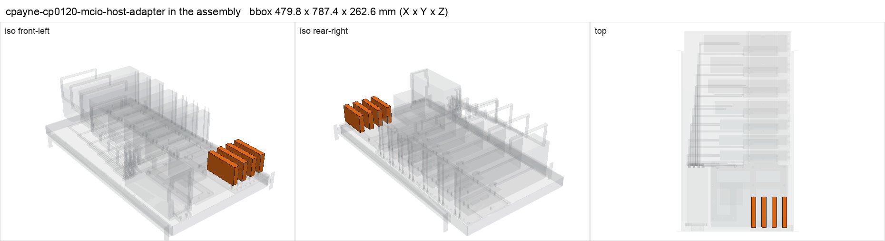

# C-Payne CP-0120 MCIO PCIe gen5 Host Adapter x16 (passive)

<!-- Generated by make check from cpayne-cp0120-mcio-host-adapter.toml and the library part.toml. Edit those, not this file. -->

Library spec: [parts/purchased/cpayne-cp0120-mcio-host-adapter](../../parts/purchased/cpayne-cp0120-mcio-host-adapter/README.md) (dimensions, interfaces, datasheets, model).

| | |
| --- | --- |
| Role | host adapter: one H12D x16 slot to two MCIO 8i ports (x8x8) |
| Status | candidate |
| Quantity | 4 |
| Systems | node |

## Assembly

- 4 instances in the assembly

## Compatibility checks

| Status | Rule | Interface | Detail |
| --- | --- | --- | --- |
| BLOCKED | count | `pcie-bifurcation-x8x8` | need 4 x pcie-bifurcation-x8x8, have None |
| BLOCKED | budget | `shelf-load` | load 18.7 kg of 39.0 kg x derate 1.0 = 39.0 kg (48% of rating); unknown load for ['amd-radeon-ai-pro-r9700'] |
| provisional | value | `pcie-x16-slot` | cpayne-cp0120-mcio-host-adapter needs PCIe x16; provided by huananzhi-h12d-8d |
| provisional | count | `pcie-x16-slot` | need 4 x pcie-x16-slot=pcie x16, have 4 |
| pass | count | `mcio-8i-port` | need 7 x mcio-8i-port, have 8 |

