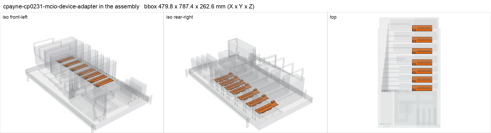

# C-Payne CP-0231 MCIO PCIe gen5 Device Adapter x8/x16 (BOTTOM)

<!-- Generated by make check from cpayne-cp0231-mcio-device-adapter.toml and the library part.toml. Edit those, not this file. -->

Library spec: [parts/purchased/cpayne-cp0231-mcio-device-adapter](../../parts/purchased/cpayne-cp0231-mcio-device-adapter/README.md) (dimensions, interfaces, datasheets, model).

| | |
| --- | --- |
| Role | GPU riser: MCIO 8i in, x16 slot (x8 electrical) for one GPU |
| Status | candidate |
| Quantity | 7 |
| Systems | node |

## Assembly

- 7 instances in the assembly

## Compatibility checks

| Status | Rule | Interface | Detail |
| --- | --- | --- | --- |
| BLOCKED | budget | `shelf-load` | load 18.7 kg of 39.0 kg x derate 1.0 = 39.0 kg (48% of rating); unknown load for ['amd-radeon-ai-pro-r9700'] |
| provisional | budget | `dc-power` | load 2205.0 W of 2800.0 W x derate 0.8 = 2240.0 W (79% of rating); relies on configured limits of ['amd-radeon-ai-pro-r9700', 'amd-rx-7900-xtx-reference', 'asrock-arc-pro-b60-creator', 'intel-arc-pro-b70', 'nvidia-rtx-3090-fe', 'nvidia-rtx-4090-fe', 'zotac-rtx-5090-solid']; unlimited peak 2755.0 W |
| provisional | count | `mcio-8i-cable` | need 7 x mcio-8i-cable, have 7 |
| provisional | count | `pcie-8pin` | need 16 x pcie-8pin, have 16 |
| provisional | value | `riser-standoff` | cpayne-cp0231-mcio-device-adapter needs M3 F/F 10 mm; provided by m3-ff-standoff-10mm |
| provisional | count | `riser-standoff` | need 28 x riser-standoff=m3 f/f 10 mm, have 28 |
| pass | value | `riser-x16-slot` | amd-radeon-ai-pro-r9700 needs PCIe x16; provided by cpayne-cp0231-mcio-device-adapter |
| pass | value | `riser-x16-slot` | amd-rx-7900-xtx-reference needs PCIe x16; provided by cpayne-cp0231-mcio-device-adapter |
| pass | value | `riser-x16-slot` | asrock-arc-pro-b60-creator needs PCIe x16; provided by cpayne-cp0231-mcio-device-adapter |
| pass | value | `riser-x16-slot` | intel-arc-pro-b70 needs PCIe x16; provided by cpayne-cp0231-mcio-device-adapter |
| pass | value | `riser-x16-slot` | nvidia-rtx-3090-fe needs PCIe x16; provided by cpayne-cp0231-mcio-device-adapter |
| pass | value | `riser-x16-slot` | nvidia-rtx-4090-fe needs PCIe x16; provided by cpayne-cp0231-mcio-device-adapter |
| pass | value | `riser-x16-slot` | zotac-rtx-5090-solid needs PCIe x16; provided by cpayne-cp0231-mcio-device-adapter |
| pass | count | `riser-x16-slot` | need 7 x riser-x16-slot=pcie x16, have 7 |

