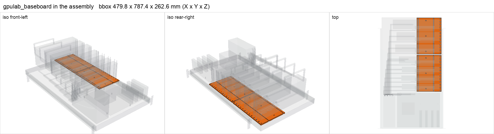

# gpulab_baseboard

<!-- Generated by make check from gpulab_baseboard.toml and the library part.toml. Edit those, not this file. -->

Library spec: [parts/printed/gpulab_baseboard](../../parts/printed/gpulab_baseboard/README.md) (dimensions, interfaces, datasheets, model).

| | |
| --- | --- |
| Role | 13-position GPU baseboard: post holes for the card brackets and sliding-nut channels for the MCIO riser boards |
| Status | design |
| Quantity | 2 |
| Systems | node |

## Assembly

- 2 instances in the assembly

## Compatibility checks

| Status | Rule | Interface | Detail |
| --- | --- | --- | --- |
| BLOCKED | budget | `shelf-load` | load 18.5 kg of 39.0 kg x derate 1.0 = 39.0 kg (47% of rating); unknown load for ['amd-radeon-ai-pro-r9700'] |
| provisional | count | `gpu-baseboard-position` | need 26 x gpu-baseboard-position, have 26 |

