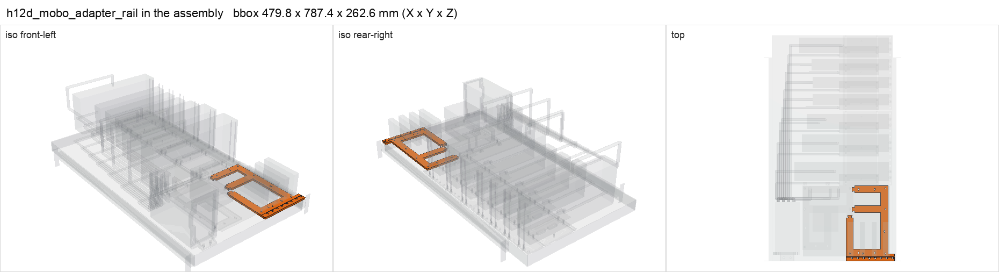

# h12d_mobo_adapter_rail

<!-- Generated by make check from h12d_mobo_adapter_rail.toml and the library part.toml. Edit those, not this file. -->

Library spec: [parts/printed/h12d_mobo_adapter_rail](../../parts/printed/h12d_mobo_adapter_rail/README.md) (dimensions, interfaces, datasheets, model).

| | |
| --- | --- |
| Role | H12D-8D mount section with the I/O-side rail, reused from AIPC (Berserk); its V100 post holes stay empty |
| Status | design |
| Quantity | 1 |
| Systems | node |

## Assembly

- 1 instances in the assembly

## Compatibility checks

| Status | Rule | Interface | Detail |
| --- | --- | --- | --- |
| BLOCKED | budget | `shelf-load` | load 20.1 kg of 39.0 kg x derate 1.0 = 39.0 kg (52% of rating); unknown load for ['amd-radeon-ai-pro-r9700'] |
| provisional | value | `mobo-rear-rail` | huananzhi-h12d-8d needs H12D-8D slot positions; provided by h12d_mobo_adapter_rail |
| provisional | count | `mobo-rear-rail` | need 1 x mobo-rear-rail=h12d-8d slot positions, have 1 |

