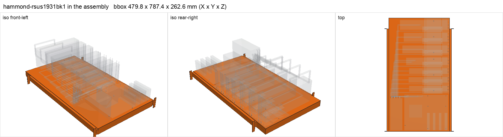

# Hammond RSUS1931BK1 solid sliding shelf with factory slides

<!-- Generated by make check from hammond-rsus1931bk1.toml and the library part.toml. Edit those, not this file. -->

Library spec: [parts/purchased/hammond-rsus1931bk1](../../parts/purchased/hammond-rsus1931bk1/README.md) (dimensions, interfaces, datasheets, model).

| | |
| --- | --- |
| Role | sliding shelf carrying the GPU lab node |
| Status | selected |
| Quantity | 1 |
| Systems | shelf, rack |

## Assembly

- 11 instances in the assembly

## Compatibility checks

| Status | Rule | Interface | Detail |
| --- | --- | --- | --- |
| BLOCKED | value | `rack-post-depth` | hammond-rsus1931bk1 needs 457.2..711.2; provider value unknown |
| BLOCKED | value | `rack-standard` | hammond-rsus1931bk1 needs EIA-310 19 in; provider value unknown |
| BLOCKED | budget | `shelf-load` | load 18.5 kg of 39.0 kg x derate 1.0 = 39.0 kg (47% of rating); unknown load for ['amd-radeon-ai-pro-r9700'] |

