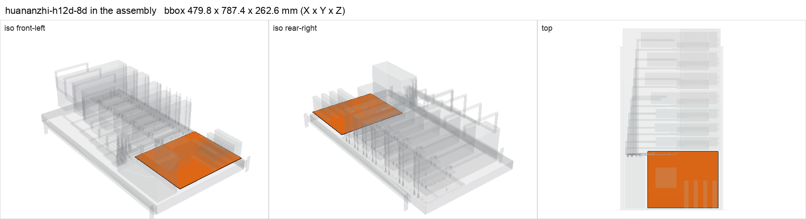

# HUANANZHI H12D-8D motherboard with BMC

<!-- Generated by make check from huananzhi-h12d-8d.toml and the library part.toml. Edit those, not this file. -->

Library spec: [parts/purchased/huananzhi-h12d-8d](../../parts/purchased/huananzhi-h12d-8d/README.md) (dimensions, interfaces, datasheets, model).

| | |
| --- | --- |
| Role | GPU lab host board: four x16 slots, each split x8x8 for two cabled GPUs |
| Status | selected |
| Quantity | 1 |
| Systems | node |

A second board is needed unless Berserk's is moved here. x8x8 bifurcation is
NOT documented in the manual or any found source: check AMD CBS -> NBIO in the
BIOS before buying adapters.

## Changes for this build

- requires `board-standoff`: no field changes — populated sites A/C/F/G/H/K/L/M; screwed from below through the drilled steel deck

## Assembly

- 1 instances in the assembly

## Compatibility checks

| Status | Rule | Interface | Detail |
| --- | --- | --- | --- |
| BLOCKED | count | `pcie-bifurcation-x8x8` | need 4 x pcie-bifurcation-x8x8, have None |
| BLOCKED | budget | `shelf-load` | load 18.5 kg of 39.0 kg x derate 1.0 = 39.0 kg (47% of rating); unknown load for ['amd-radeon-ai-pro-r9700'] |
| provisional | count | `atx-24pin` | need 1 x atx-24pin, have 1 |
| provisional | value | `board-standoff` | huananzhi-h12d-8d needs #6-32 F/F; provided by keystone-1451b |
| provisional | count | `board-standoff` | need 8 x board-standoff=#6-32 f/f, have 8 |
| provisional | budget | `dc-power` | load 2205.0 W of 2800.0 W x derate 0.8 = 2240.0 W (79% of rating); relies on configured limits of ['amd-radeon-ai-pro-r9700', 'amd-rx-7900-xtx-reference', 'asrock-arc-pro-b60-creator', 'intel-arc-pro-b70', 'nvidia-rtx-3090-fe', 'nvidia-rtx-4090-fe', 'zotac-rtx-5090-solid']; unlimited peak 2755.0 W |
| provisional | count | `eps-8pin-cpu` | need 2 x eps-8pin-cpu, have 2 |
| provisional | value | `pcie-x16-slot` | cpayne-cp0120-mcio-host-adapter needs PCIe x16; provided by huananzhi-h12d-8d |
| provisional | count | `pcie-x16-slot` | need 4 x pcie-x16-slot=pcie x16, have 4 |
| pass | value | `cpu-socket` | amd-epyc-7702p needs SP3; provided by huananzhi-h12d-8d |

