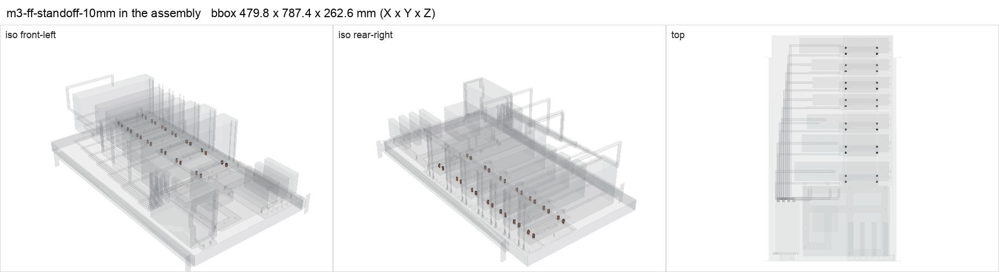

# M3 x 10 mm female/female hex standoff, SW5.5

<!-- Generated by make check from m3-ff-standoff-10mm.toml and the library part.toml. Edit those, not this file. -->

Library spec: [parts/purchased/m3-ff-standoff-10mm](../../parts/purchased/m3-ff-standoff-10mm/README.md) (dimensions, interfaces, datasheets, model).

| | |
| --- | --- |
| Role | riser board standoffs on the baseboard nut channels |
| Status | candidate |
| Quantity | 28 |
| Systems | node |

## Assembly

- 28 instances in the assembly

## Compatibility checks

| Status | Rule | Interface | Detail |
| --- | --- | --- | --- |
| BLOCKED | budget | `shelf-load` | load 20.1 kg of 39.0 kg x derate 1.0 = 39.0 kg (52% of rating); unknown load for ['amd-radeon-ai-pro-r9700'] |
| provisional | value | `riser-standoff` | cpayne-cp0231-mcio-device-adapter needs M3 F/F 10 mm; provided by m3-ff-standoff-10mm |
| provisional | count | `riser-standoff` | need 28 x riser-standoff=m3 f/f 10 mm, have 28 |

