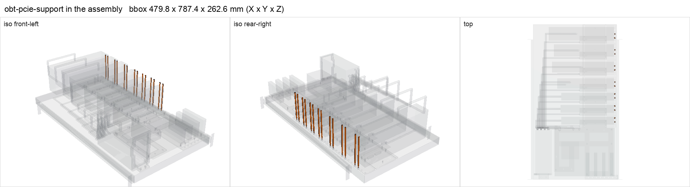

# Open Benchtable PCI-E support rod with nut

<!-- Generated by make check from obt-pcie-support.toml and the library part.toml. Edit those, not this file. -->

Library spec: [parts/purchased/obt-pcie-support](../../parts/purchased/obt-pcie-support/README.md) (dimensions, interfaces, datasheets, model).

| | |
| --- | --- |
| Role | GPU bracket posts (two per card) |
| Status | selected |
| Quantity | 14 |
| Systems | node |

## Assembly

- 28 instances in the assembly

## Compatibility checks

| Status | Rule | Interface | Detail |
| --- | --- | --- | --- |
| BLOCKED | budget | `shelf-load` | load 18.7 kg of 39.0 kg x derate 1.0 = 39.0 kg (48% of rating); unknown load for ['amd-radeon-ai-pro-r9700'] |
| pass | value | `post-base-thread` | obt-pcie-support needs M3 female; provided by wurth-970140324 |
| pass | count | `post-base-thread` | need 14 x post-base-thread=m3 female, have 14 |

